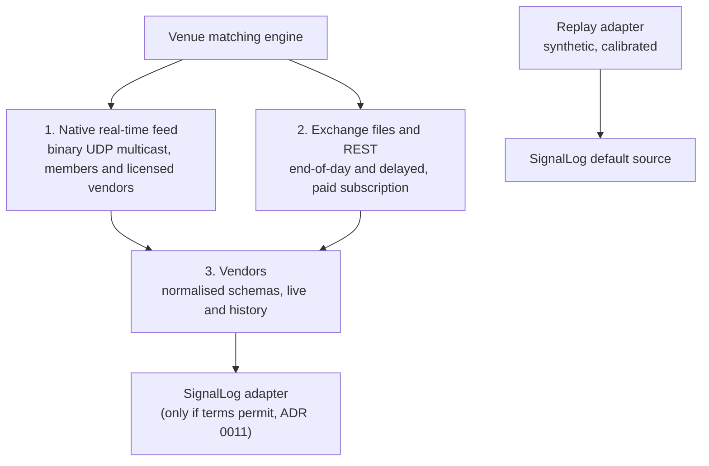

# Market data sources

Where exchange price data comes from, in which formats, at what cost and under which terms, and why SignalLog's default source is replay. The decision is in [ADR 0011](../adr/0011-market-data-sourcing-and-licensing.md); the budget is [NFR-COST-01](../requirements/nfr.md#nfr-cost-01); the licence rule is [NFR-LEGAL-01](../requirements/nfr.md#nfr-legal-01). Terms are explained in the [glossary](glossary.md); the sources are in the [bibliography](../references/index.md), with the date each was checked.

## 1. Three layers of exchange data

There is no single "tick format". Each venue publishes the same market in up to three layers, each with its own format, latency and terms.

### 1.1 Native real-time feeds

| Venue | Protocol | Encoding | Content |
|---|---|---|---|
| ICE Futures Europe (`IFEU`), ICE Endex (`NDEX`) | iMpact, UDP multicast[^databento-ndex-impact] | Message specification by ICE; logins and requests over TCP[^b2bits-impact-multicast] | Full order depth and top-5 price levels, each with live and snapshot channels[^b2bits-impact-multicast]; messages include Add/Modify Order, Delete Order, Add/Change/Delete Price Level, Trade, Cancelled Trade, Market Snapshot, Market State Change and End of Day Market Summary[^onixs-impact-net] |
| EEX (`XEEE`, on Deutsche Börse T7) | EOBI, EMDI, MDI, RDI | EOBI fixed-length binary; EMDI and MDI in FAST | EOBI order by order; EMDI unnetted, with price-level snapshots; MDI netted; RDI reference data[^deutsche-boerse-2017-10-05-interfaces] |
| CME Group (not in scope) | MDP 3.0, UDP multicast | Simple Binary Encoding (SBE), one XML schema with the templates of all messages[^cme-mdp3-message-schema] | Market by order (full depth) and 10-deep market by price[^cme-mdp3-market-data] |

**Inferred:** all of them require a licence, a network connection to the venue or a co-location provider, and conformance testing, so none is reachable from a portfolio project.

### 1.2 Exchange files and REST

| Source | Formats | Notes |
|---|---|---|
| EEX Group DataSource | REST API (XML, CSV, JSON); end-of-day files (CSV, XLSX) with full history[^eex-datasource] | Subscriptions per market, ordered in the EEX webshop |
| EPEX SPOT sFTP | CSV, for example day-ahead auction prices and volumes per market area[^epex-sftp-specifications] | Availability depends on the subscription; power, not in scope |

### 1.3 Vendors with normalised schemas

**Databento** covers ICE Futures Europe (`IFEU.IMPACT`) and ICE Endex (`NDEX.IMPACT`) from iMpact, with history from 2018-12-23 on a T+1 basis.[^databento-2024-01-18-ice] Its futures venues are CME, CBOT, NYMEX, COMEX, ICE Endex and ICE Futures Europe; **EEX is not covered**.[^databento-venues]

| Aspect | Value |
|---|---|
| Schemas | MBO, MBP-1, MBP-10, Trades, OHLCV, Definition, Statistics, Status, among others[^databento-schemas] |
| Output | DBN (binary), convertible to CSV or JSON[^databento-dbn] |
| Prices | Fixed-point integers in units of 1e-9[^databento-common-fields] |
| Timestamps | Nanoseconds; `ts_event` (venue) and `ts_recv` (capture)[^databento-common-fields] |
| Live data | Exchange licence fees for each ICE feed start at USD 875/month[^databento-2024-01-18-ice] |
| Historical data | Priced per GB used; new accounts receive USD 125 in credits valid for 6 months. Whether ICE licence fees also apply to historical downloads is not stated.[^databento-pricing-credits] |

**ICE Consolidated Feed** normalises data from more than 600 sources with over 10 years of tick history (enterprise product).[^ice-consolidated-feed]

## 2. What this means for SignalLog

| Path | Cost per month | Terms | Fit |
|---|---|---|---|
| Native feeds | licence + connectivity, far above budget | Membership or vendor licence | ✗ |
| EEX DataSource | paid subscription | Licence | ✗ for the budget |
| Databento live (ICE) | ≥ USD 875 + plan | Licence; terms for public display not checked | ✗ (budget is USD 20, NFR-COST-01) |
| Databento history (ICE), one-off | within the USD 125 credit for a small sample | **Open:** whether derived statistics may be published | Possible, only to calibrate replay |
| Replay adapter | 0 | None | ✓ default (ADR 0011) |

**Conclusion.** Live exchange data is not affordable and could not be shown publicly anyway. SignalLog keeps replay as the default source. Real data, if used at all, enters only as **calibration statistics** (price level, volatility, tick intervals), and only after the source's terms are recorded in `docs/legal/data-sources.md`. Raw licensed series are never stored in the repository.

## 3. One event model across venues

Every layer above carries the same five kinds of information. SignalLog's contract ([ADR 0012](../adr/0012-message-contract-and-versioning.md)) covers most of them; the Databento schema names are used here as a neutral reference.

| Kind | Databento schema[^databento-schemas] | iMpact (ICE)[^onixs-impact-net] | T7 (EEX)[^deutsche-boerse-2017-10-05-interfaces] | SignalLog |
|---|---|---|---|---|
| Instrument definition | Definition | Futures Product Definition | RDI | Reference data `instruments.json` ([ADR 0014](../adr/0014-instrument-domain-model.md)) |
| Trade | Trades | Trade, Cancelled Trade | not checked | `PriceTick`, `priceType = LAST` |
| Top of book | MBP-1 | Top-5 price levels | EMDI | `PriceTick`, `priceType = BID` / `ASK` |
| Full order book | MBO, MBP-10 | Full order depth | EOBI | **Not needed** for monitoring |
| Statistics | Statistics | End of Day Market Summary, Settlement Price | not checked | `priceType = SETTLE`; open interest and volume are candidates for a minor contract version |
| Market status | Status | Market State Change | not checked | Event `signallog.market.status.v1`; effective status combines sessions and reported status ([ADR 0019](../adr/0019-market-status-events.md)) |

Confirmations of existing decisions:

- **Two timestamps.** Vendors separate venue time (`ts_event`) and capture time (`ts_recv`), as SignalLog separates `eventTimeUtc` and `receivedTimeUtc` (ADR 0017).
- **Exact prices.** Vendors use fixed-point integers; SignalLog uses `decimal` constrained to the tick size. An adapter converts explicitly (`price × 1e-9`, then validates against the tick size).
- **Instrument identity by venue.** Vendors key instruments by venue dataset, as SignalLog keys them by MIC.

## 4. Venues, segments and identifiers

| Venue | [MIC](../standards/concepts-and-sources.md#mic)[^iso-10383] | Relevance |
|---|---|---|
| ICE Futures Europe (London, FCA)[^ice-futures-europe-regulation] | `IFEU` | Brent, JKM in the starter set; also lists a TTF mirror (`TFN`), not in the starter set |
| ICE Endex derivatives (Amsterdam, AFM)[^ice-endex-regulation] | `NDEX` | TTF in the starter set |
| ICE Endex spot | `NDXS` | Within-day and spot gas; out of scope ([tenors](tenors-and-delivery-periods.md#7-out-of-scope-for-now)) |
| European Energy Exchange | `XEEE` | THE gas month in the starter set |

**One hub, two venues.** On 2023-02-20 ICE Futures Europe launched Dutch TTF natural gas futures and options in London.[^spglobal-2023-02-20-ttf-london] ICE announced them as a mirror of the ICE Endex contracts that would not be subject to the EU's Market Correction Mechanism (MCM) and its price cap; ICE Endex announced a rulebook change to apply the mechanism from 2023-02-15.[^ice-2023-01-27-mcm] The mechanism ended on 2025-01-31 without ever being triggered.[^acer-2025-01-31-mcm] The London futures are still in ICE's product guide under the code `TFN`.[^ice-tfn]

The two contracts are specified the same way; they differ in venue, regulator, MIC and code:[^ice-tfm][^ice-tfn]

| Field | ICE Endex | ICE Futures Europe |
|---|---|---|
| Venue, regulator, MIC | Amsterdam, AFM, `NDEX` | London, FCA, `IFEU` |
| Code | `TFM` | `TFN` |
| Contract size | 1 MW × hours of delivery (23, 24 or 25 per day) | same |
| Quote, tick | EUR/MWh, 0.005 | same |
| Minimum size | 5 lots on screen; 1 lot for EFP, EFS and blocks | same |
| Delivery | physical, TTF Virtual Trading Point (Gasunie Transport Services) | same |
| Trading hours, London time | 00:50–22:00 | same |
| Last trading day | 18:00 CET, two UK business days before the delivery period | close of business, two UK business days before the delivery period |
| Listing cycle | up to 156 consecutive months, plus quarter, season and calendar strips | same |
| Clearing | ICE Clear Europe | same |

They are therefore different instruments: `NDEX.TFM.<period>` and `IFEU.TFN.<period>`. A price from one venue is never stored under the other, even though both settle at the same hub. In 2023 ICE described ICE Endex as the world's most liquid trading venue for TTF futures and options;[^ice-2023-01-27-mcm] how much trades on `TFN` today was not checked (section 6). The starter set uses ICE Endex `TFM`.

**Nasdaq Commodities** is no longer a relevant venue: Euronext completed the acquisition of its Nordic power futures business in July 2025.[^fow-2025-07-31-euronext] An earlier agreement under which EEX would have acquired that business was terminated on 2024-06-26.[^eex-2024-06-26-nasdaq]

## 5. Lessons from production data formats

Former employer data seen by the project author (volume forecasts and deal prices, not market data) is **not** used in SignalLog: it is confidential and it is not market data. It confirmed requirements that the model must support:

- **Units and currencies per product.** Some gas products are quoted in pence per therm, not in pounds (**Inferred** for ICE UK NBP; to verify in the contract specification before such a product is added). A currency `GBX` and unit `therm` would be required.
- **Effective-dated reference data.** Hub codes change: French gas zones were merged into a single trading point (**Inferred**: November 2018; to verify), yet older data still carried the old zone codes. Hub reference data needs validity dates, like market conventions in ADR 0017.
- **Delivery periods as start and end dates.** Forecast observations carried a start and an end date per period, which matches the extent of a `DeliveryPeriod` in ADR 0014.
- **IEC 62325 (ENTSO-E).** The IEC framework for energy market communications; ENTSO-E's library lists IEC 62325-451-6 for the publication of market information, which the Transparency Platform uses.[^entsoe-edi-library] Relevant only if power enters scope.

## 6. Open questions

| Question | Why it matters | Where to look |
|---|---|---|
| May statistics derived from Databento historical ICE data be published? | Calibration of replay from real TTF and Brent history | Databento terms of service and ICE data policies |
| Do ICE licence fees apply to historical downloads? | Cost of one-off calibration | Databento support, ICE market data fee schedule |
| Terms of the EIA Brent spot series, including whether EIA credits a third-party vendor as the source of its spot prices | Planned calibration source for Brent | EIA copyright and reuse page; series notes |
| How much trades on ICE Futures Europe TTF (`TFN`) compared with ICE Endex (`TFM`)? | Whether `TFN` could ever be a useful second TTF source; it is listed (section 4) | ICE Report Center daily volumes and open interest |

[^databento-ndex-impact]: [Databento, ICE Endex data feed specifications](../references/index.md#databento-ndex-impact): ICE disseminates full order depth, market by price, top of book and statistics over iMpact, received by UDP multicast.
[^b2bits-impact-multicast]: [B2BITS, iMpact multicast feed configuration](../references/index.md#b2bits-impact-multicast): channel groups with live and snapshot feeds; TCP requests and responses defined by the ICE message specification.
[^onixs-impact-net]: [OnixS, iMpact handler for .NET](../references/index.md#onixs-impact-net): message classes of the namespace.
[^deutsche-boerse-2017-10-05-interfaces]: [Deutsche Börse 2017](../references/index.md#deutsche-boerse-2017-10-05-interfaces), slides on EOBI, EMDI, MDI and RDI.
[^cme-mdp3-message-schema]: [CME, MDP 3.0 message schema](../references/index.md#cme-mdp3-message-schema).
[^cme-mdp3-market-data]: [CME, MDP 3.0 market data](../references/index.md#cme-mdp3-market-data): CME MDP UDP feed.
[^eex-datasource]: [EEX Group DataSource](../references/index.md#eex-datasource): REST API and end-of-day prices.
[^epex-sftp-specifications]: [EPEX SPOT sFTP file specifications](../references/index.md#epex-sftp-specifications), section 2.4.1.
[^databento-2024-01-18-ice]: [Databento, 2024-01-18](../references/index.md#databento-2024-01-18-ice).
[^databento-venues]: [Databento, venues](../references/index.md#databento-venues).
[^databento-schemas]: [Databento, schemas and data formats](../references/index.md#databento-schemas).
[^databento-dbn]: [Databento Binary Encoding](../references/index.md#databento-dbn).
[^databento-common-fields]: [Databento, common fields](../references/index.md#databento-common-fields): prices and timestamps.
[^databento-pricing-credits]: [Databento, usage pricing and data credits](../references/index.md#databento-pricing-credits).
[^ice-consolidated-feed]: [ICE Consolidated Feed fact sheet](../references/index.md#ice-consolidated-feed).
[^ice-futures-europe-regulation]: [ICE Futures Europe regulation](../references/index.md#ice-futures-europe-regulation).
[^ice-endex-regulation]: [ICE Endex regulation](../references/index.md#ice-endex-regulation).
[^iso-10383]: [ISO 10383](../references/index.md#iso-10383): the MIC list.
[^spglobal-2023-02-20-ttf-london]: [S&P Global, 2023-02-20](../references/index.md#spglobal-2023-02-20-ttf-london).
[^ice-2023-01-27-mcm]: [ICE press release, 2023-01-27](../references/index.md#ice-2023-01-27-mcm).
[^acer-2025-01-31-mcm]: [ACER, 2025-01-31](../references/index.md#acer-2025-01-31-mcm).
[^ice-tfn]: [ICE, TTF futures on ICE Futures Europe (`TFN`)](../references/index.md#ice-tfn).
[^ice-tfm]: [ICE, TTF futures on ICE Endex (`TFM`)](../references/index.md#ice-tfm).
[^fow-2025-07-31-euronext]: [FOW, 2025-07-31](../references/index.md#fow-2025-07-31-euronext).
[^eex-2024-06-26-nasdaq]: [EEX press release, 2024-06-26](../references/index.md#eex-2024-06-26-nasdaq).
[^entsoe-edi-library]: [ENTSO-E, EDI library](../references/index.md#entsoe-edi-library).
