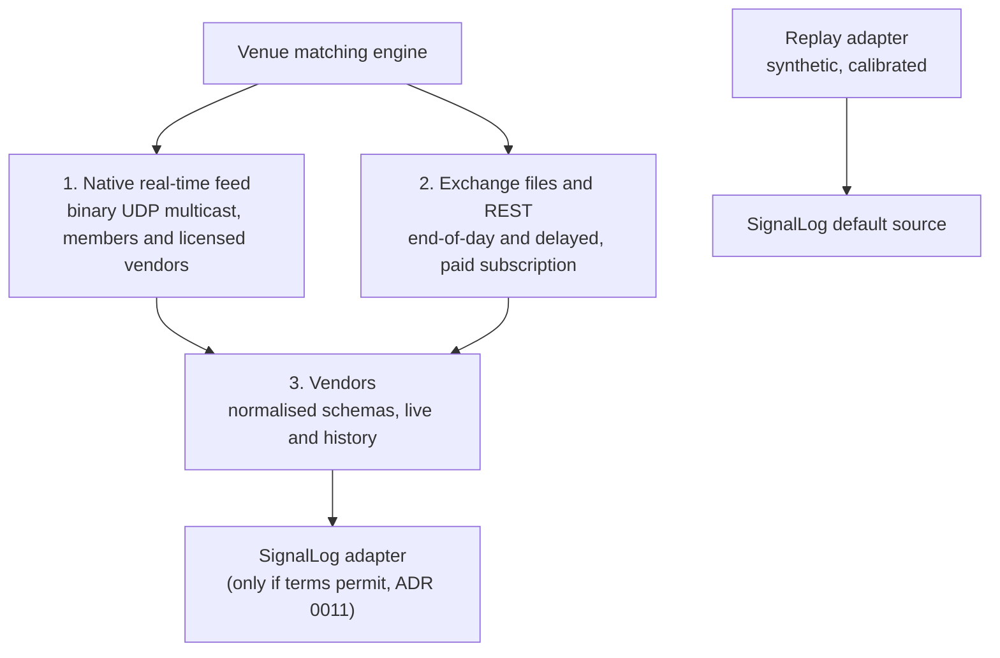

# Market data sources

Where exchange price data comes from, in which formats, at what cost and under which terms, and why SignalLog's default source is replay. The decision is in [ADR 0011](../adr/0011-market-data-sourcing-and-licensing.md); the budget is [NFR-COST-01](../requirements/nfr.md#nfr-cost-01); the licence rule is [NFR-LEGAL-01](../requirements/nfr.md#nfr-legal-01). Facts were checked on 2026-11-03 unless marked otherwise.

## 1. Three layers of exchange data

There is no single "tick format". Each venue publishes the same market in up to three layers, each with its own format, latency and terms.

### 1.1 Native real-time feeds

| Venue | Protocol | Encoding | Content |
|---|---|---|---|
| ICE Futures Europe (`IFEU`), ICE Endex (`NDEX`) | iMpact multicast | Binary messages; static instrument data over TCP before multicast | Full order depth and top-5 price levels, each with live and snapshot channels; Add/Modify/Delete Order, Price Level changes, Trade, Cancelled Trade, Market Snapshot, End of Day Market Summary |
| EEX (`XEEE`, on Deutsche Börse T7) | EOBI, EMDI, MDI, RDI | EOBI fixed-length binary; EMDI and MDI in FAST | EOBI order by order; EMDI aggregated price levels; MDI netted, published at intervals; RDI reference data |
| CME Group (not in scope) | MDP 3.0 | Simple Binary Encoding (SBE), schema in an XML template | Market by order and market by price |
| EPEX SPOT (power, not in scope) | M7 | AMQP messages | Continuous intraday trading |

All of them require a licence, a network connection to the venue or a co-location provider, and conformance testing. None is reachable from a portfolio project.

### 1.2 Exchange files and REST

| Source | Formats | Notes |
|---|---|---|
| EEX Group DataSource | REST (XML, CSV, JSON); sFTP end-of-day files (CSV, XLSX) with full history | Paid subscription |
| EPEX SPOT sFTP | CSV, for example day-ahead auction results per bidding zone | Paid subscription; power, not in scope |
| CME DataMine | FIX, RLC; PCAP of the full feed with nanosecond timestamps | Not in scope |

### 1.3 Vendors with normalised schemas

**Databento** covers ICE Futures Europe (`IFEU.IMPACT`) and ICE Endex (`NDEX.IMPACT`) from iMpact, with history from 2018-12-23 on a T+1 basis. Its futures venues are CME, CBOT, NYMEX, COMEX, ICE Endex and ICE Futures Europe; **EEX is not covered**.

| Aspect | Value |
|---|---|
| Schemas | MBO, MBP-1, MBP-10, Trades, OHLCV, Definition, Statistics, Status |
| Output | DBN (binary), CSV, JSON |
| Prices | Fixed-point integers in units of 1e-9 |
| Timestamps | Nanoseconds; `ts_event` (venue) and `ts_recv` (capture) |
| Live data | Exchange licence fees for each ICE feed start at USD 875/month |
| Historical data | Priced per GB used; new accounts receive USD 125 in credits valid for 6 months. Whether ICE licence fees also apply to historical downloads is not stated. |

**ICE Consolidated Feed** normalises data from more than 600 sources with over 10 years of tick history (enterprise product).

## 2. What this means for SignalLog

| Path | Cost per month | Terms | Fit |
|---|---|---|---|
| Native feeds | licence + connectivity, far above budget | Membership or vendor licence | ✗ |
| EEX DataSource | paid subscription | Licence | ✗ for the budget |
| Databento live (ICE) | ≥ USD 875 + plan | Licence; public display needs separate rights | ✗ (budget is USD 20, NFR-COST-01) |
| Databento history (ICE), one-off | within the USD 125 credit for a small sample | **Open:** whether derived statistics may be published | Possible, only to calibrate replay |
| Replay adapter | 0 | None | ✓ default (ADR 0011) |

**Conclusion.** Live exchange data is not affordable and could not be shown publicly anyway. SignalLog keeps replay as the default source. Real data, if used at all, enters only as **calibration statistics** (price level, volatility, tick intervals), and only after the source's terms are recorded in `docs/legal/data-sources.md`. Raw licensed series are never stored in the repository.

## 3. One event model across venues

Every layer above carries the same five kinds of information. SignalLog's contract ([ADR 0012](../adr/0012-message-contract-and-versioning.md)) covers most of them; the Databento schema names are used here as a neutral reference.

| Kind | Databento schema | iMpact (ICE) | T7 (EEX) | SignalLog |
|---|---|---|---|---|
| Instrument definition | Definition | static data over TCP | RDI | Reference data `instruments.json` ([ADR 0014](../adr/0014-instrument-domain-model.md)) |
| Trade | Trades | Trade, Cancelled Trade | EOBI/EMDI trade | `PriceTick`, `priceType = LAST` |
| Top of book | MBP-1 | Top-5 price levels | EMDI | `PriceTick`, `priceType = BID` / `ASK` |
| Full order book | MBO, MBP-10 | Full order depth | EOBI | **Not needed** for monitoring |
| Statistics | Statistics | End of Day Market Summary | not checked | `priceType = SETTLE`; open interest and volume are candidates for a minor contract version |
| Market status | Status | not checked | not checked | **Gap**: staleness uses sessions from reference data only ([ADR 0017](../adr/0017-time-and-timezones.md), [ADR 0018](../adr/0018-latency-and-freshness-targets.md)) |

Confirmations of existing decisions:

- **Two timestamps.** Vendors separate venue time (`ts_event`) and capture time (`ts_recv`), as SignalLog separates `eventTimeUtc` and `receivedTimeUtc` (ADR 0017).
- **Exact prices.** Vendors use fixed-point integers; SignalLog uses `decimal` constrained to the tick size. An adapter converts explicitly (`price × 1e-9`, then validates against the tick size).
- **Instrument identity by venue.** Vendors key instruments by venue dataset, as SignalLog keys them by MIC.

## 4. Venues, segments and identifiers

| Venue | MIC | Relevance |
|---|---|---|
| ICE Futures Europe (London, FCA) | `IFEU` | Brent, JKM in the starter set |
| ICE Endex derivatives (Amsterdam, AFM) | `NDEX` | TTF in the starter set |
| ICE Endex spot | `NDXS` | Within-day and spot gas; out of scope ([tenors](tenors-and-delivery-periods.md#7-out-of-scope-for-now)) |
| European Energy Exchange | `XEEE` | THE gas month in the starter set |

**One hub, two venues.** In 2023 ICE listed TTF futures on ICE Futures Europe in parallel with ICE Endex, so that a market outside the EU's Market Correction Mechanism existed. The mechanism ended on 31 January 2025 without ever being triggered. Whether the London TTF contracts are still listed was not checked. Either way, they would be different instruments (`IFEU.<code>.<period>`) from ICE Endex TTF (`NDEX.TFM.<period>`).

**Nasdaq Commodities** is no longer a relevant venue: its European power business moved to EEX, and its Nordic power futures were acquired by Euronext.

## 5. Lessons from production data formats

Former employer data seen by the project author (volume forecasts and deal prices, not market data) is **not** used in SignalLog: it is confidential and it is not market data. It confirmed requirements that the model must support:

- **Units and currencies per product.** Some gas products are quoted in pence per therm, not in pounds (**Inferred** for ICE UK NBP; to verify in the contract specification before such a product is added). A currency `GBX` and unit `therm` would be required.
- **Effective-dated reference data.** Hub codes change: French gas zones were merged into a single trading point (**Inferred**: November 2018; to verify), yet older data still carried the old zone codes. Hub reference data needs validity dates, like market conventions in ADR 0017.
- **Delivery periods as start and end dates.** Forecast observations carried a start and an end date per period, which matches the extent of a `DeliveryPeriod` in ADR 0014.
- **IEC 62325 (ENTSO-E).** A public standard for power market documents; relevant only if power enters scope, since the ENTSO-E Transparency Platform publishes in it.

## 6. Open questions

| Question | Why it matters | Where to look |
|---|---|---|
| May statistics derived from Databento historical ICE data be published? | Calibration of replay from real TTF and Brent history | Databento terms of service and ICE data policies |
| Do ICE licence fees apply to historical downloads? | Cost of one-off calibration | Databento support, ICE market data fee schedule |
| Terms of the EIA Brent spot series, including whether EIA credits a third-party vendor as the source of its spot prices | Planned calibration source for Brent | EIA copyright and reuse page; series notes |
| Should `MarketStatus` become its own event type? | Staleness during venue halts, not only outside sessions | ADR 0012 (contract), ADR 0013 (control plane) |
| Are London TTF futures on ICE Futures Europe still listed? | Avoid confusing two TTF venues | ICE product guide |

## Sources

- Databento, ICE Futures Europe and ICE Endex now available — https://databento.com/blog/ice-futures-market-data (checked 2026-11-03)
- Databento, NDEX.IMPACT dataset — https://databento.com/docs/datasets/ndex-impact (checked 2026-11-03)
- Databento, supported venues — https://app0.databento.com/venues (checked 2026-11-03)
- Databento, usage pricing and data credits — https://databento.com/docs/faqs/usage-pricing-and-data-credits (checked 2026-11-03)
- OnixS, ICE iMpact handler FAQ — https://ref.onixs.biz/cpp-ice-impact-handler-guide/faq.html
- B2BITS, ICE iMpact multicast feed configuration — https://b2bits.atlassian.net/wiki/spaces/B2BITS/pages/6080809/ICE+iMpact+MD+Handler+Multicast+Feed+Configuration
- Deutsche Börse, recent developments in market and reference data interfaces — https://www.mds.deutsche-boerse.com/resource/blob/1336012/5cca065c005cdb086eef8773f201a8b5/data/Recent%20developments%20in%20market%20and%20reference%20data%20interfaces.pdf
- Databento, T7 glossary — https://databento.com/microstructure/t7
- CME Group, MDP 3.0 Simple Binary Encoding — https://cmegroupclientsite.atlassian.net/wiki/spaces/EPICSANDBOX/pages/46468732
- EEX Group DataSource — https://www.eex.com/de/market-data/eex-group-datasource
- EPEX SPOT, sFTP specifications (2020-07) — https://www.epexspot.com/sites/default/files/download_center_files/SFTP_specifications_2020-07.pdf
- ICE Consolidated Feed fact sheet — https://www.ice.com/publicdocs/ICE_Consolidated_Feed_FactSheet.pdf
- ICE Endex, regulation — https://www.ice.com/endex/regulation
- ACER, 31 January 2025 marks the final day of the MCM — https://www.acer.europa.eu/news-and-events/news/31-january-2025-marks-final-day-market-correction-mechanism-mcm (checked 2026-11-03)
- Mondo Visione, EEX and Nasdaq Commodities announce transfer of Nasdaq's European power business (2023) — https://mondovisione.com/media-and-resources/news/eex-and-nasdaq-commodities-announce-intention-to-transfer-nasdaqs-european-powe-2023620/
- FOW, Euronext completes Nasdaq Nordic futures acquisition — https://www.fow.com/insights/euronext-completes-nasdaq-nordic-futures-acquisition
