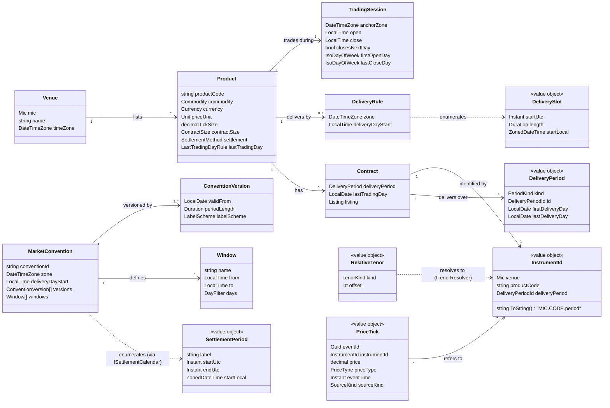

# Domain model

The model follows the decisions in [ADR 0014](../adr/0014-instrument-domain-model.md) (instruments) and [ADR 0017](../adr/0017-time-and-timezones.md) (time). Terms are defined in the [glossary](glossary.md).

## Overview

## Building blocks

### Reference data (stored, changed through pull requests)

| Element | Source of truth | Notes |
|---|---|---|
| `Venue` | `contracts/reference/instruments.json` | MIC, name, zone |
| `Product` with `TradingSession`, `DeliveryRule`, `LastTradingDayRule` | `contracts/reference/instruments.json` | Each product records its specification URL and check date |
| `MarketConvention` with versions and windows | `contracts/reference/market-conventions.json` (planned) | Effective-dated; see [market conventions](market-conventions.md) |
| Calibration parameters | `contracts/reference/calibration.json` (planned) | Derived statistics only; never raw licensed prices |

### Events (stored, append-only)

| Element | Where | Notes |
|---|---|---|
| `PriceTick` | Service Bus `price-ticks`, Cosmos DB `price-ticks` | CloudEvents envelope, UUIDv7 `eventId`, UTC timestamps (ADR 0012) |

### Computed (never stored as source of truth)

| Element | Computed by | From |
|---|---|---|
| `Contract` list and last trading days | `Product` + `LastTradingDayRule` | reference data and a calendar |
| Instrument for a relative tenor (`DA`, `M+1`, `Cal+1`) | `ITenorResolver.Resolve(product, tenor, asOf)` | listed contracts, last trading days, venue rules |
| Continuous series and roll points | resolved instrument per instant | stored ticks + `ITenorResolver` |
| Start/end instants and hours of a delivery period | `DeliveryRule` over the period's extent | extent + tzdb |
| Session open/close instants for a trading day | `TradingSession.For(LocalDate)` | session rule + tzdb |
| `DeliverySlot`s of a delivery day | `DeliveryRule.SlotsFor(LocalDate)` | delivery rule + tzdb |
| `SettlementPeriod`s and labels | `ISettlementCalendar.PeriodsFor(LocalDate)` | market convention version + tzdb |
| Indices (Base, Peak) | aggregation of prices over a `Window` | settlement periods + stored prices |
| Daily bars | change feed over `price-ticks`, keyed by trading day | stored ticks + trading sessions |

## Invariants

1. Every stored timestamp is an instant in UTC. Local times exist only in reference-data rules and in labels of projections.
2. `InstrumentId` is `{MIC}.{productCode}.{deliveryPeriodId}`; the MIC and product code must exist in reference data and the product must list the period kind. Relative tenors are never part of an id.
3. Prices are `decimal`, never floating point; a price is a multiple of the product's tick size.
4. A delivery day's length is the elapsed time between its two UTC boundaries; volumes follow BR-TIME-01.
5. A tick belongs to the trading day of the session that contains its `eventTime`; a tick outside every session is flagged, not silently assigned.
6. Market conventions are effective-dated; a report uses the version valid for its delivery date and records that version and the tzdb version.
7. NodaTime types do not cross the domain boundary; contracts use ISO 8601 strings and `DateTimeOffset`.

## Open questions

- Holiday calendars per venue: source and format (needed for staleness and contract expiry).
- Venue rules for `DA`, `BOW`, `WDNW` and `BOM` per product beyond TTF (see [tenors and delivery periods](tenors-and-delivery-periods.md)).
- Whether power products enter scope; if so, conventions for EPEX and GB (see [market conventions](market-conventions.md)).
