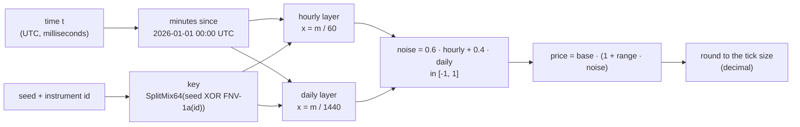
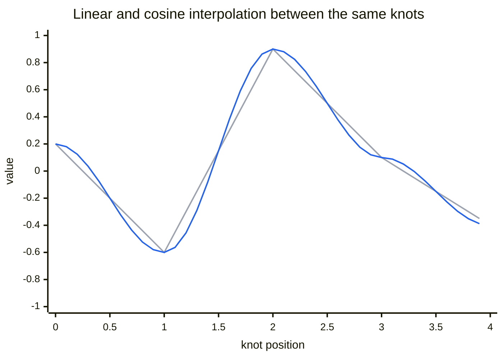
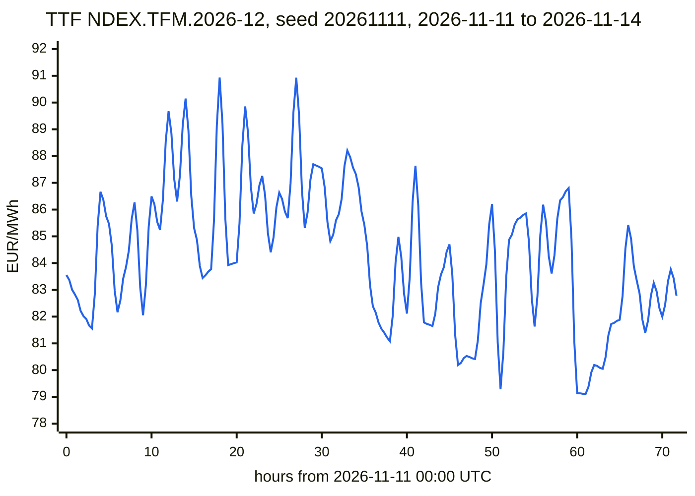

# Replay price generator

How the replay adapter turns a seed, an instrument and a moment in time into a believable last price: why the price is a pure function rather than a random walk, how the random numbers are made without `System.Random`, how cosine interpolation smooths them, and how the result is kept inside a band and on the tick grid. The decision to use replay as the default source is in [ADR 0011](../adr/0011-market-data-sourcing-and-licensing.md) and on [Market data sources](market-data-sources.md); the code is `ReplaySource` in `src/SignalLog.Adapters.Core`. Figures on this page were computed on 2026-11-12 by running that code.

## 1. The problem: a price without memory

The usual way to simulate a price is a **random walk**: each price is the previous one plus a random step.

```text
P(n) = P(n-1) + e(n)        e(n) a random step, for example ±0.07
```

A random walk needs the previous price. The replay adapter cannot keep it:

- `ReplayAdapter` is a timer function on Azure Functions Flex Consumption ([ADR 0006](../adr/0006-compute-hosting.md)). Between runs the app can scale to zero, and the next run may start in a new process on another machine, so nothing held in memory survives.
- Storing the last price outside (a blob, a database) adds infrastructure and a race when two instances run at once.
- Replaying the walk from a fixed start on every run would add up about 450,000 one-minute steps by November 2026, and the result would still depend on the random generator staying the same (section 4).

The generator therefore computes the price as a **pure function**:

```text
price = f(seed, instrument, time)
```

The same arguments always give the same price, on any machine, in any process, with no state. The price at 09:15 is computed directly, without the price at 09:14, yet consecutive minutes still join into a smooth line (section 7).

## 2. The pipeline at a glance



Each layer is **value noise**: random values fixed at evenly spaced knots, joined by cosine interpolation. The technique comes from procedural graphics, where it draws clouds, terrain and marble ([Perlin 1985](#sources)).

## 3. From time to knots

Time becomes a real number of minutes since a fixed epoch, 2026-01-01 00:00 UTC:

```text
m = (t - 2026-01-01T00:00:00Z) in minutes        about 450,795 at 2026-11-11 09:15
```

Each layer divides `m` by its knot spacing and splits the result into a whole part (the knot to the left) and a fraction (the position between two knots):

```text
hourly layer:  x = m / 60      k = floor(x)    f = x - k      (f from 0 to 1)
daily layer:   x = m / 1440    k = floor(x)    f = x - k
```

At 09:15 the hourly layer is a quarter of the way from the 09:00 knot to the 10:00 knot: `f = 0.25`.

## 4. Random values at the knots

Every knot `k` needs a random value `r(k)` in `[-1, 1)` with three properties:

| Property | Why |
|---|---|
| Deterministic | The same key and knot always give the same value, so the price is reproducible |
| Random-looking | Neighbouring knots 7,513 and 7,514 give unrelated values |
| Direct access | The value of knot `k` is computed without generating knots 0 to `k - 1` |

A random number generator such as `System.Random` is a **stream**: the 7,513th value needs the 7,512 before it. The generator uses a **hash function** instead, which mixes its input so thoroughly that the output looks random.

### 4.1 SplitMix64

SplitMix64 is the finalizer of the generator by Steele, Lea and Flood ([2014](#sources)). It takes a 64-bit value and mixes its bits:

```text
z = x + 0x9E3779B97F4A7C15
z = (z XOR (z >> 30)) · 0xBF58476D1CE4E5B9
z = (z XOR (z >> 27)) · 0x94D049BB133111EB
return z XOR (z >> 31)
```

All arithmetic is modulo 2^64: the bits above the 64th are dropped, which in C# is `unchecked` `ulong` arithmetic. Two properties matter:

- **Every step is a bijection.** Adding a constant is reversible; multiplying by an odd constant is reversible modulo 2^64 (an odd number has a multiplicative inverse); `z XOR (z >> s)` is reversible, because the top `s` bits are unchanged and reveal the next ones. So the function permutes all 2^64 values and never maps two inputs to one output.
- **Avalanche.** Shifts with XOR move high bits into low bits, multiplications move low bits into high bits. After three rounds, flipping one input bit flips about half of the output bits, so knots 7,513 and 7,514, which differ in one bit, produce unrelated values.

The first constant is 2^64 divided by the golden ratio φ ≈ 1.618, a common choice because its bits have no regular pattern.

### 4.2 From 64 bits to a value in [-1, 1)

```text
u = (bits >> 11) · 2^-53        53 high bits → a double in [0, 1)
r = 2u - 1                      → [-1, 1)
```

A `double` has a 53-bit significand, so every one of the 2^53 values is represented exactly and all are equally likely.

### 4.3 A key per instrument and seed

If TTF and Brent shared one noise, their lines would move in step. Each instrument therefore has its own key:

```text
key = SplitMix64(seed XOR FNV-1a(instrumentId))
r(k) = SplitMix64(key XOR (k · 0x9E3779B97F4A7C15))     mapped to [-1, 1) as in 4.2
```

**FNV-1a** (Fowler–Noll–Vo, [IETF draft](#sources)) XORs each input byte into the hash and multiplies by the FNV prime. The generator uses the 64-bit offset basis and prime, but feeds the instrument id one UTF-16 code unit at a time instead of one byte; instrument ids are ASCII ([ADR 0014](../adr/0014-instrument-domain-model.md)), so this is a stable, deterministic variant, not the byte-exact FNV-1a value:

```text
h = 0xCBF29CE484222325                  offset basis
for each character c:  h = (h XOR c) · 0x100000001B3     modulo 2^64
```

The **seed** (default 20261111) selects a whole family of paths: another seed gives other prices for the same instruments and times. The daily layer XORs the key with a constant ("salt") so that its knots do not reuse the hourly values.

### 4.4 Why not System.Random or string.GetHashCode

- `new Random(seed)` is a stream (no direct access), and its sequence for a seed is not promised to stay the same: Microsoft's documentation notes that the same seed "may produce different sequences of random numbers if run on different versions of .NET" ([Random class](#sources)). A runtime upgrade could then change every replayed price without a change in SignalLog.
- `string.GetHashCode()` is randomized per process in .NET: "two subsequent runs of the same program may return different hash codes" ([String.GetHashCode](#sources)). Each function run would get another key, and the price would jump to a random place in the band every minute. FNV-1a, written out in the code, gives the same 64 bits everywhere.

## 5. Cosine interpolation

Between two knots the layer moves from value `a` to value `b`. **Linear interpolation**, `a + (b - a) · f`, joins the knots with straight segments and makes a corner at each knot: the price would change direction exactly on the hour.

**Cosine interpolation** replaces the fraction `f` with a smooth weight:

```text
w(f) = (1 - cos(π · f)) / 2
value = a + (b - a) · w(f)
```

| f | cos(π·f) | w(f) |
|---|---|---|
| 0 | 1 | 0 |
| 0.25 | 0.7071 | 0.1464 |
| 0.5 | 0 | 0.5 |
| 0.75 | -0.7071 | 0.8536 |
| 1 | -1 | 1 |

`w` starts and ends with zero slope, so the curve arrives at a knot and leaves it without a corner. Example at 09:15 with `a = 0.2` at 09:00 and `b = -0.6` at 10:00: `0.2 + (-0.8) · 0.1464 = 0.0829`.

The chart joins the same five knot values (0.2, -0.6, 0.9, 0.1, -0.4) both ways: the grey linear line turns sharply at each knot, the blue cosine line rounds every turn.



Cosine interpolation keeps the curve smooth at the knots, but not its second derivative; smoother schemes (cubic, Perlin's quintic fade) exist and are not needed for a price display.

## 6. Two layers

One hourly layer gives waves an hour long. A second, daily layer adds a slow drift, so that some days trade higher and some lower:

```text
noise = 0.6 · hourly(m / 60) + 0.4 · daily(m / 1440)
```

Each layer lies in `[-1, 1]` and the weights add up to 1, so the noise also lies in `[-1, 1]`.

## 7. From noise to a price

```text
price = base · (1 + range · noise)
final = round(price / tick) · tick         round half to even, in decimal
```

The defaults ([ReplayOptions](#sources)) sit near the market of November 2026:

| Instrument | Base | Range | Band | Tick size |
|---|---|---|---|---|
| TTF `NDEX.TFM.2026-12` | 85 EUR/MWh | ±8 % | 78.20 – 91.80 EUR/MWh | 0.005 EUR/MWh |
| Brent `IFEU.BRN.2027-01` | 91 USD/bbl | ±6 % | 85.54 – 96.46 USD/bbl | 0.01 USD/bbl |

Example: a raw TTF price of 82.7263 EUR/MWh divided by the tick of 0.005 EUR/MWh is 16,545.26 ticks, rounded to 16,545 ticks, times 0.005 EUR/MWh is **82.725 EUR/MWh**. The arithmetic is in `decimal`, as [ADR 0012](../adr/0012-message-contract-and-versioning.md) requires for prices; only the noise itself is a `double`.

Three days of TTF at one sample every 20 minutes, from 2026-11-11 00:00 UTC (the adapter runs every minute):



Over these three days, one price per minute (4,321 prices per instrument):

| Instrument | Lowest | Highest | Distinct prices | Largest one-minute step |
|---|---|---|---|---|
| TTF | 79.110 EUR/MWh | 90.935 EUR/MWh | 1,683 | 0.205 EUR/MWh |
| Brent | 86.49 USD/bbl | 94.85 USD/bbl | 785 | 0.16 USD/bbl |

## 8. How large can one minute's step be

The steepest part of a cosine segment is its middle, where the slope of `w` is π/2 per knot interval. Between knots of -1 and +1 the layer changes by at most

```text
(π / 2) · 2 per knot interval
hourly layer:  π / 60 ≈ 0.052 per minute      weighted 0.6  → 0.031
daily layer:   π / 1440 ≈ 0.0022 per minute   weighted 0.4  → 0.0009
noise:         at most ≈ 0.032 per minute
```

For TTF that bounds a one-minute step at `85 · 0.08 · 0.032 ≈ 0.22` EUR/MWh, plus up to one tick from rounding; the largest observed step is 0.205 EUR/MWh. The test `Consecutive_minutes_move_by_small_steps` allows 10 % of the band per minute (0.68 EUR/MWh for TTF), well above the bound.

## 9. What the tests guarantee

| Property | Test in `tests/SignalLog.Adapters.Tests` |
|---|---|
| The same seed and time give the same ticks in another instance | `Same_seed_and_time_give_the_same_ticks_in_another_instance` |
| Another seed gives other prices | `Another_seed_gives_other_prices` |
| Prices stay in the band, on the tick grid, and move between runs | `Prices_stay_in_the_band_on_the_tick_grid_and_move_between_runs` |
| Consecutive minutes move by small steps | `Consecutive_minutes_move_by_small_steps` |
| Ticks are REPLAY LAST prices at the current millisecond | `Ticks_are_replay_last_prices_of_every_instrument_at_the_current_millisecond` |
| The events of a run validate against the v1 schema | `Publishes_one_event_per_instrument_that_validates_against_the_v1_schema` |

## 10. Limits

The generator draws a believable line, not a model of the market:

- The price never leaves its band and always drifts back towards the base; real prices trend and break out.
- There are no jumps (Brent fell more than 8 % on one day in early November 2026), no fat tails and no changes in volatility.
- There are no trading sessions, weekends, holidays or outages, so the alerting rules of [ADR 0017](../adr/0017-time-and-timezones.md) cannot be exercised yet.

The next replay stories address these: reference data for instruments, calibration from public statistics ([market data sources](market-data-sources.md), section 2), sessions and injected faults. They can replace the formula without touching anything else, because it sits behind `IMarketDataSource`.

## Sources

Checked on 2026-11-12.

- Ken Perlin, "An Image Synthesizer", SIGGRAPH 1985, Computer Graphics 19(3), pp. 287–296, [doi:10.1145/325165.325247](https://doi.org/10.1145/325165.325247): procedural noise from random values at lattice points with smooth interpolation.
- Guy L. Steele Jr., Doug Lea, Christine H. Flood, "Fast Splittable Pseudorandom Number Generators", OOPSLA 2014, pp. 453–472, [doi:10.1145/2660193.2660195](https://doi.org/10.1145/2660193.2660195): SplitMix64 and its mixing function.
- Glenn Fowler, Landon Curt Noll, Kiem-Phong Vo, Donald Eastlake, Tony Hansen, "The FNV Non-Cryptographic Hash Algorithm", Internet-Draft draft-eastlake-fnv-31, March 2025, [ietf.org](https://www.ietf.org/archive/id/draft-eastlake-fnv-31.html): FNV-1a, 64-bit offset basis 0xCBF29CE484222325 and prime 0x100000001B3.
- Microsoft Learn, [Random class](https://learn.microsoft.com/dotnet/api/system.random): a seeded sequence may differ between .NET versions.
- Microsoft Learn, [String.GetHashCode](https://learn.microsoft.com/dotnet/api/system.string.gethashcode): hash codes may differ between runs, versions and platforms.
- SignalLog code: `ReplaySource` and `ReplayOptions` in [src/SignalLog.Adapters.Core](https://github.com/AlexeyGane/signallog/tree/main/src/SignalLog.Adapters.Core); tests in [tests/SignalLog.Adapters.Tests](https://github.com/AlexeyGane/signallog/tree/main/tests/SignalLog.Adapters.Tests).
