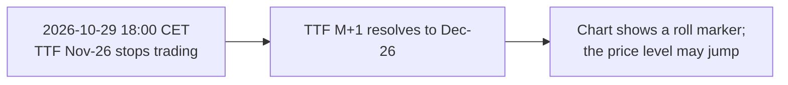

# Tenors and delivery periods

What a gas or power contract delivers, how long that is, and what traders mean by "day-ahead" or "M+1". The decisions are in [ADR 0014](../adr/0014-instrument-domain-model.md) (revision 2); time rules are in [ADR 0017](../adr/0017-time-and-timezones.md) and [Time and delivery](time-and-delivery.md). Facts were checked on 2026-11-01 unless marked otherwise.

## 1. Two questions that look like one

A trader who says "TTF day-ahead is 82.50 EUR/MWh" (an illustrative price) answers two questions at once:

1. **Which contract?** The gas day of Monday 2026-11-09 on ICE Endex. This is an absolute fact and never changes.
2. **Why that one?** Because on Friday 2026-11-06 the day-ahead is the next weekday. This is a relative label that points to a different contract every trading day.

SignalLog stores the first and computes the second. A stored price always names an absolute delivery period; "DA", "M+1", "Cal+1" and "front month" are labels resolved at read time.

## 2. Delivery periods on the in-scope venues

### ICE Endex — Dutch TTF Natural Gas Daily Futures

From the contract specification (all times CET, gas day 06:00 to 06:00):

| Period | Delivery |
|---|---|
| Day-Ahead (DA) | One gas day on the next weekday; if UK bank holidays fall before Saturday or after Sunday, the first weekday after them |
| Balance of Week (BOW) | 2–4 consecutive gas days starting Tuesday, Wednesday or Thursday and ending Saturday 06:00 |
| Weekend (W/END) | Saturday 06:00 to Monday 06:00; 3 or 4 days when UK bank holidays fall on the Friday or Monday |
| Saturday, Sunday | One gas day each |
| Working Days Next Week (WK/DY NW) | Monday 06:00 to Saturday 06:00, UK bank holidays excluded |
| Balance of Month (BOM) | From two business days ahead to the end of the month; not listed on some end-of-month days |

Up to 92 consecutive daily contracts can be listed. Unit of trading: 1 MW for each hour of each gas day (23, 24 or 25). Trading stops at 18:00 CET on the business day before delivery starts.

### ICE Endex — Dutch TTF Natural Gas Futures (monthly)

Up to 156 consecutive month contracts. "Quarterly, seasonal, calendar, and any period of consecutive monthly contracts can be registered as a strip": a quarter is traded as three month contracts at one price, not as a contract of its own.

### EEX — power futures

Maturities: day, weekend, week, month, quarter, year, and for some markets season and fiscal year. For German power: the next 11 days, the next 2 weekends, the current and next 4 weeks, months, quarters and years (counts vary by market). EEX power futures use **cascading**: a year contract is replaced by its quarters and months as delivery approaches, a quarter by its months.

### Oil and LNG

Brent and JKM are listed as month contracts only. Their relative tenors (`M+n`) work the same way, but no daily or weekend periods exist.

## 3. Identifiers

The identifier format is defined in ADR 0014. Summary:

| Kind | Example id | Reads as |
|---|---|---|
| Day | `2026-11-09` | Gas day of Monday 9 November 2026 |
| Weekend | `2026-12-25-WE` | Weekend starting with the gas day of Friday 25 December 2026 |
| Balance of week | `2026-11-04-BOW` | From gas day 4 November to the end of that week |
| Week | `2026-W46` | ISO week 46 of 2026, Monday 9 to Sunday 15 November |
| Working days of week | `2026-W46-WD` | Working days of ISO week 46 |
| Balance of month | `2026-11-04-BOM` | From gas day 4 November to the end of November |
| Month | `2026-12` | December 2026 |
| Quarter | `2027-Q1` | January–March 2027 |
| Season | `2026-WIN`, `2027-SUM` | Winter 2026 = October 2026–March 2027; Summer 2027 = April–September 2027 |
| Gas year | `2026-GY` | October 2026–September 2027 |
| Calendar year | `2027` | January–December 2027 |

Full instrument ids: `NDEX.TFM.2026-12`, `NDEX.TFM.2026-12-25-WE`, `XEEE.<code>.2027-Q1`.

**Why the weekend is anchored on its first day.** The weekend starting Friday 2026-12-25 runs to Tuesday 2026-12-29 06:00, because 25 and 28 December 2026 are UK bank holidays (Boxing Day falls on a Saturday and moves to Monday). Encoding the end date would make the id depend on a holiday calendar; anchoring on the first day keeps it unique and short. The extent is stored with the contract.

## 4. Lengths and volumes

Delivered energy follows BR-TIME-01: capacity × elapsed hours ([ADR 0017](../adr/0017-time-and-timezones.md)). For 1 MW at TTF (Europe/Amsterdam, gas day 06:00–06:00):

| Period | Gas days | Hours = MWh | Why |
|---|---|---|---|
| `2026-11-07-WE` | 2 | 48 | ordinary weekend |
| `2026-10-24-WE` | 2 | 49 | gas day 2026-10-24 contains the October transition (25 h) |
| `2026-12-25-WE` | 4 | 96 | Christmas and the moved Boxing Day |
| `2026-11-04-BOM` | 27 | 648 | 4–30 November (**Inferred**: "two business days ahead" read from a Monday 2026-11-02 trade date) |
| `2026-10` | 31 | 745 | one 25-hour gas day |
| `2026-11` | 30 | 720 | no transition |
| `2027-03` | 31 | 743 | gas day 2027-03-27 is 23 h (transition on Sunday 28 March) |
| `2027-Q1` | 90 | 2,159 | contains the March transition |
| `2026-WIN` | 182 | 4,368 | both transitions cancel out |
| `2027-SUM` | 183 | 4,392 | no transition |
| `2026-GY` | 365 | 8,760 | both transitions cancel out |

These rows are the unit tests listed in ADR 0014.

## 5. Relative tenors

| Label | Meaning | Resolution rule |
|---|---|---|
| `DA` | Day-ahead | Venue rule per product (TTF: next weekday after UK bank holidays) |
| `WE` | Next weekend | The next weekend contract that is tradable |
| `BOW`, `WDNW` | Balance of week, working days next week | Venue rule per product |
| `BOM` | Balance of month | The BOM contract listed for the trading day, if any |
| `FM`, `M+1` | Front month | The first month contract still tradable at the given instant |
| `M+n` | n-th month | The n-th month contract still tradable |
| `Q+n`, `WIN+n`, `SUM+n`, `GY+n`, `Cal+n` | n-th quarter, season, gas year, year | The n-th period of the kind, by start of delivery, whose every leg is still tradable |

### Worked examples

| As of | Product | Tenor | Result | Reason |
|---|---|---|---|---|
| Mon 2026-11-02 10:00 UTC | TTF | `M+1` | `NDEX.TFM.2026-12` | November 2026 stopped trading on Thu 2026-10-29 (two UK business days before Sunday 1 November) |
| Mon 2026-11-02 10:00 UTC | Brent | `M+1` | `IFEU.BRN.2027-01` | December 2026 expired on Fri 2026-10-30; January 2027 trades until Mon 2026-11-30 |
| Fri 2026-11-06 10:00 UTC | TTF | `DA` | `NDEX.TFM.2026-11-09` | Next weekday after Friday is Monday |
| Fri 2026-11-06 10:00 UTC | TTF | `WE` | `NDEX.TFM.2026-11-07-WE` | Saturday 06:00 to Monday 06:00 |

Note the first two rows: on the same day, "M+1" is December for TTF and January for Brent. "Next calendar month" would be wrong for both, which is why the rule is "first still tradable".

### Continuous series and rolls

A continuous series for a tenor is the price of the resolved instrument over time. When the resolved instrument changes, the series **rolls**:

The jump at a roll is real: two different contracts have two different prices. SignalLog shows raw prices with roll markers. A back-adjusted series (shifting history by the difference or ratio at each roll) is offered only as a display option and is labelled "adjusted", because adjusted prices were never traded.

## 6. Listed contracts, strips and cascading

| Concept | Example | How SignalLog stores it |
|---|---|---|
| Listed contract | TTF day-ahead, EEX Cal-27 | An instrument; ticks refer to it |
| Strip | ICE Endex TTF Q1-27 (three months at one price) | An instrument with `listing = Strip` and its legs in reference data, only if a source publishes a strip price; leg prices are never invented |
| Cascading | EEX Cal-27 → Q1-27 + Q2-27 + Q3-27 + Q4-27 | `cascadesInto` in reference data; the year and its quarters are different instruments |

## 7. Out of scope for now

- **Power day-ahead auctions** (EPEX SPOT, SDAC): one price per 15-minute period of a delivery day ([market conventions](market-conventions.md)). The shape of the data is a curve per day, not a price per contract, so it needs its own decision.
- **Within-day gas**: continuous spot trading for the current gas day; deferred with spot markets.

## 8. Open questions

| Question | Why it matters | Where to look |
|---|---|---|
| Exact BOM listing calendar ("may not be listed on certain end-of-month days") | Reference data for BOM extents | ICE Endex trading calendar |
| UK bank holiday calendar as reference data | Extents of WE, BOW, WDNW and DA rules | gov.uk bank holidays JSON feed (licence to check) |
| Product codes of TTF daily products and EEX German power maturities | Instrument ids | ICE product guide, EEX product list |
| Does any permitted live source publish strip prices? | Whether `listing = Strip` is needed in the first release | Data sources review ([ADR 0011](../adr/0011-market-data-sourcing-and-licensing.md)) |

## Sources

- ICE Endex, Dutch TTF Natural Gas Daily Futures, contract specification — https://www.ice.com/api/productguide/spec/45436633/pdf (checked 2026-11-01)
- ICE Endex, Dutch TTF Natural Gas Futures, contract specification — https://www.ice.com/api/productguide/spec/27996665/pdf (checked 2026-11-01)
- EEX, Power Futures — https://eex.com/en/markets/power/power-futures (checked 2026-11-01)
- Brent and TTF last trading day rules: [market conventions](market-conventions.md), section 1
