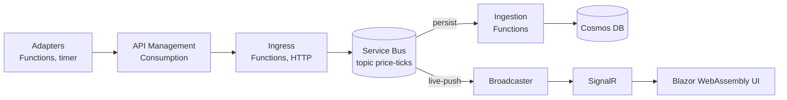

# SignalLog

**Cloud-native, event-driven commodity market data platform on Azure, built with .NET 10.**

SignalLog ingests futures prices for crude oil, natural gas and LNG from ICE Futures Europe, ICE Endex and EEX through pluggable adapters, transports them over Azure Service Bus, stores them in Azure Cosmos DB and pushes live updates to a Blazor WebAssembly UI. The name is an anagram: **OIL + GAS + LNG → SIGNAL LOG**.

This site is the project's engineering record. It is built from the `docs/` folder of the [repository](https://github.com/AlexeyGane/signallog) on every merge to `main`.

## Architecture at a glance

The design carries a W3C trace context across every arrow and authenticates every service with a managed identity ([ADR 0005](adr/0005-identity-and-access.md), [ADR 0007](adr/0007-observability.md)); the replay adapter is the default data source because live exchange data is licensed ([ADR 0011](adr/0011-market-data-sourcing-and-licensing.md)).

## Where to start

| If you want to know… | Read |
|---|---|
| Why the system looks the way it does | [Architecture decisions](adr/README.md): 21 ADRs with context, drivers, considered options and consequences |
| What quality the system must reach, and how it is checked | [Non-functional requirements](requirements/nfr.md) |
| Which domain rules any implementation must respect | [Business rules](requirements/business-rules.md) |
| What the domain terms mean | [Glossary](domain/glossary.md) and the [domain model](domain/model.md) |
| How exchanges define delivery periods, sessions and prices | [Time and delivery](domain/time-and-delivery.md), [Tenors and delivery periods](domain/tenors-and-delivery-periods.md), [Market conventions](domain/market-conventions.md) |
| How work moves from an idea to production | [Branching and release standard](standards/branching-and-release.md), [Documentation standard](standards/documentation.md) |
| Where a concept or definition comes from | [Concepts and their sources](standards/concepts-and-sources.md) |

## How the work is traced

Each Feature in Azure Boards follows from an Epic justified by an ADR, references the NFRs it must meet and the C4 element it changes, and reaches a release through User Stories, pull requests that carry `AB#<id>` in their titles, and CI checks. Each NFR names the ADRs that address it, and each ADR names the NFRs it serves.

## Status

Solution skeleton with guardrails in CI: banned-API fitness function, UUIDv7 event identifiers with tests, actions pinned to commit SHAs, work-item references in pull request titles. The Azure environment and the first end-to-end slice are next ([ADR 0016](adr/0016-environments-and-infrastructure-as-code.md)).
