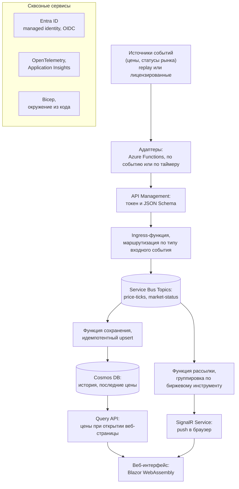
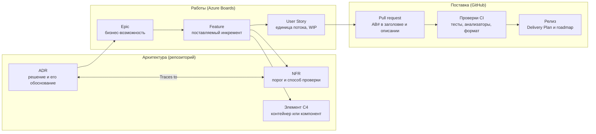

---
search:
  exclude: true
robots: noindex, nofollow
---

<!--
Unlisted page: not in the navigation, excluded from search, marked noindex and
removed from sitemap.xml by eng/docs/remove-unlisted-from-sitemap.py.
Source of truth: this file (the Claude document it was first written in only
points here now). Written in Russian on purpose (see docs/standards/documentation.md).
-->

# SignalLog — пояснительная записка к проекту

Alexey Gane · редакция от 2026-11-07

## Содержание {#contents}

1. [Резюме](#summary)
2. [О проекте](#about)
3. [Перенос на научные и образовательные проекты Life Science](#life-science)
4. [Архитектура](#architecture)
5. [Технологический стек](#stack)
6. [Процессы разработки](#process)
7. [Архитектурные решения (ADR)](#adr)
8. [Нефункциональные требования (NFR)](#nfr)
9. [Доменная база знаний и диаграммы](#domain)
10. [Работа с источниками](#sources)
11. [Методологии](#methods)
12. [Анализ данных](#data)
13. [Выводы](#conclusions)
14. [Текущее состояние и план развития](#status)
15. [Ссылки](#links)

## Резюме {#summary}

SignalLog — это демонстрационный проект, облачная событийно-ориентированная платформа мониторинга биржевых цен на нефть, газ и сжиженный природный газ (СПГ). Цель данного проекта — показать, как я веду инженерную работу целиком: от исследования предметной области и источников до архитектурных решений, требований к качеству, автоматических проверок и процесса поставки.

Предметная область здесь биржевая, но потенциальная ценность для научных и образовательных проектов — в методе, а не в теме:

- **работа с источниками:** каждое утверждение о внешнем мире подкреплено первоисточником и датой проверки ([ADR 0013](adr/0013-adapter-control-plane.md#more-information), [ADR 0007](adr/0007-observability.md#cost-controls)), догадки помечены ([источники рыночных данных](domain/market-data-sources.md#5-lessons-from-production-data-formats), [сроки поставки](domain/tenors-and-delivery-periods.md#4-lengths-and-volumes)), противоречия разобраны и исправлены ([ADR 0000](adr/0000-cost-optimization-strategy.md#context-and-problem-statement), [ADR 0008](adr/0008-data-storage.md#context-and-problem-statement), [ADR 0009](adr/0009-event-driven-ingestion.md#event-grid));
- **методология решений:** 21 архитектурное решение (Architecture Decision Records, ADR) в формате MADR (Markdown Architectural Decision Records, см. описание формата на <https://adr.github.io/madr/>) со взвешенным сравнением вариантов и способом проверки;
- **измеримые требования:** [каталог](requirements/nfr.md) из 24 нефункциональных требований (Non-Functional Requirements, NFR) с порогами величин, методами проверки и трассировкой к архитектурным решениям (ADR);
- **работа с данными:** временные ряды, единицы измерения, часовые пояса и переход на летнее/зимнее время, справочные данные с правилами и периодами применимости (действия), калибровка порогов значений используемых величин по реальным замерам;
- **документация как код:** вся документация, диаграммы и [база знаний](domain/README.md) предметной области хранятся в репозитории и проходят ревью вместе с кодом (см. описание принципа Docs as Code [на Write the Docs](https://writethedocs.org/guide/docs-as-code)).

Проект публичный: [github.com/AlexeyGane/signallog](https://github.com/AlexeyGane/signallog) (код), документация опубликована на сайте [alexeygane.github.io/signallog](index.md). Текущее состояние честно описано в разделе «Текущее состояние и план развития»: архитектура и документация проработаны, каркас решения и непрерывная интеграция (Continuous Integration, CI) работают, облачное окружение ещё не развёрнуто.

## О проекте {#about}

Цель SignalLog — показать, как система строится по правилам крупной организации, но одним человеком и с бюджетом на техническую эксплуатацию не больше 20 долларов в месяц. Платформа получает цены из нескольких источников, сохраняет историю, показывает цены в браузере в реальном времени и предупреждает, когда данные перестали поступать.

**Как биржи публикуют цены.** Биржа сводит заявки покупателей и продавцов и публикует несколько видов цен на каждый заключённый контракт: цену последней сделки, лучшие цены покупки и продажи (bid и ask) и официальную расчётную цену дня (settlement), по которой считается маржа. Данные распространяются по лицензии: в реальном времени — через фиды бирж и вендоров, с задержкой или файлами за конец дня ([подробнее об источниках](domain/market-data-sources.md)).

**Тик** — одно наблюдение цены одного инструмента в один момент: цена, её тип (последняя сделка, bid, ask или settlement), валюта, единица измерения, время события на бирже и источник (живой или replay). Тик — основная единица данных SignalLog ([глоссарий](domain/glossary.md#prices-and-data)).

**Предметная область.** Стартовый набор — четыре биржевых продукта (см. Product в [глоссарии проекта, раздел Markets and Instruments](domain/glossary.md#markets-and-instruments)) на трёх биржах:

| Продукт | Биржа (код MIC — Market Identifier Code, ISO 10383) | Котировка |
| --- | --- | --- |
| Нефть Brent | ICE (Intercontinental Exchange) Futures Europe (IFEU) | USD за баррель |
| Газ TTF (виртуальный газовый хаб Title Transfer Facility, Нидерланды) | ICE Endex (NDEX) | EUR за МВт·ч |
| СПГ JKM (Japan Korea Marker — ценовой индикатор Platts для СПГ в Северо-Восточной Азии) | ICE Futures Europe (IFEU) | USD за MMBtu (миллион британских тепловых единиц) |
| Газ THE (виртуальный газовый хаб Trading Hub Europe, Германия) | EEX (European Energy Exchange, XEEE) | EUR за МВт·ч |

Единицы измерения определены в [глоссарии, раздел Volumes and units](domain/glossary.md#volumes-and-units).

**Почему эта область.** Я много лет работал с системами энергетического трейдинга и знаю её трудные места изнутри. Она хорошо проверяет инженерную строгость: одна и та же «цена газа» существует в десятках контрактов, сутки поставки длятся 23, 24 или 25 часов, точность расчёта объёмов поставки электроэнергии зависит от сопротивления линий электропередач, газовые хранилища имеют ограниченную вместимость, свежесть и корректность данных напрямую влияет на тактические и стратегические финансовые решения (иногда макроэкономического масштаба), а данные бирж лицензируются.

**Границы.**

- Платформа только наблюдает за ценами: торговли, заявок и позиций нет.
- Источник по умолчанию — синтетические данные, генерируемые replay-механизмом, откалиброванным по публичной статистике. Живые данные бирж подключаются только после проверки их лицензии.
- Электроэнергия и спотовые аукционы пока вне рамок; их закономерности записаны в [базе знаний](domain/README.md), чтобы модель их не исключала: расчётные периоды аукциона на сутки вперёд, окна peak/base и индексы — в [рыночных конвенциях](domain/market-conventions.md), разделы 2 и 3; правило хранения — в [ADR 0017](adr/0017-time-and-timezones.md), раздел 5. Физические перетоки и потери в сети не моделируются.

## Перенос на научные и образовательные проекты Life Science {#life-science}

Задачи научных и научно-образовательных проектов структурно похожи: данные приходят из разнородных источников со своими форматами и лицензиями, их нужно хранить воспроизводимо, показывать неспециалистам и обосновывать ссылками на источники. Поэтому практики из этого проекта переносятся напрямую.

| Практика в SignalLog | Аналог в научных и образовательных проектах |
| --- | --- |
| Каждый факт о бирже — со ссылкой на первоисточник и датой проверки; догадки помечены **Inferred** | Научно-популярные и образовательные материалы со ссылками на публикации, разделение установленного и гипотез |
| Источники данных подключаются только после проверки лицензии и записи условий использования | Учёт лицензий на датасеты, изображения и тексты на публичных сайтах проектов |
| Справочные данные с датами действия и источником в каждой записи | Классификаторы и номенклатуры (таксономия, онтологии), чьи версии меняются со временем |
| Единицы и валюты — часть модели, а не подпись к числу | Единицы измерения в измерительных данных, пересчёт без потери точности |
| Время всегда в UTC (всемирное координированное время), местное время — правила и подписи; тесты на реальных датах с учётом перехода на летнее/зимнее время | Данные приборов и экспедиций из разных часовых поясов, длительные наблюдения |
| Синтетические данные, откалиброванные по реальной статистике, вместо публикации чужих данных | Учебные и демонстрационные наборы данных без раскрытия исходных |
| Требования к качеству с числовыми порогами и процедурой их калибровки по измерениям | Воспроизводимость вычислений, описанная методика измерения |
| [База знаний](domain/README.md) предметной области: глоссарий, модель, разобранные примеры, открытые вопросы | Общий язык с учёными-заказчиками; термины в коде совпадают с терминами предметной области |
| Документация как код, публикация в виде статического веб-сайта (Zensical) | Сайты научных и просветительских проектов с версиями и ревью текста |

Эти же принципы лежат в основе принятых в науке принципов FAIR (Findable, Accessible, Interoperable, Reusable) — данные должны быть находимыми, доступными, совместимыми и пригодными для повторного использования ([Wilkinson et al., 2016](https://www.nature.com/articles/sdata201618)): стабильные идентификаторы, явные лицензии, стандартные форматы и происхождение каждой записи.

Несмотря на то, что данный проект построен на использовании облачных технологий Microsoft Azure, решения не привязаны к ним по сути. Каждый облачный сервис в архитектуре — лишь реализация типовой роли: брокер сообщений, вызов функций по событию, документное хранилище, шлюз API. Такие роли есть и в российских облачных решениях, а также реализуемы в собственной инфраструктуре на открытом программном обеспечении (например, RabbitMQ или Kafka, PostgreSQL).

## Архитектура {#architecture}

Архитектура событийная: источники и потребители данных связаны только через брокер сообщений и версионируемый контракт. Поэтому новый источник или новый потребитель добавляется без изменения остальных частей, а отказ потребителя не теряет данные.

*Источники и потребители связаны только через брокер и контракт.*

Все стрелки проходят через Service Bus: адаптеры не знают о потребителях, а новый потребитель — это новая подписка на топик.

Путь одного тика (цены):

1. **Адаптер** получает цену от источника (replay или лицензированный источник) и формирует событие в формате CloudEvents с идентификатором UUIDv7 (Universally Unique Identifier версии 7).
2. **Шлюз API Management** проверяет токен и JSON схему сообщения; невалидное сообщение отклоняется с кодом 400.
3. **Ingress-функция** публикует событие в топик Service Bus.
4. **Подписки топика** раздают событие независимым потребителям: функция сохранения пишет в Cosmos DB, функция рассылки отправляет цену в браузеры через SignalR.
5. **Веб-интерфейс** (Blazor WebAssembly) показывает цену, её возраст, источник (`LIVE` или `REPLAY`) и статус рынка.

Свойства, которые заложены в архитектуру:

- **Идемпотентность.** Один и тот же идентификатор события служит ключом дедупликации в брокере и идентификатором документа в базе: повторная доставка не создаёт дублей.
- **Без секретов.** Все сервисы аутентифицируются управляемыми удостоверениями (managed identity), CI — через OpenID Connect (OIDC); паролей и ключей в конфигурации нет.
- **Наблюдаемость.** Контекст трассировки по стандарту W3C (World Wide Web Consortium) Trace Context передаётся через все звенья; один тик можно проследить от адаптера до базы.
- **Разделение «работает» и «данные идут».** Пульс адаптера и свежесть данных отслеживаются отдельно; алерт о свежести не срабатывает вне торговых сессий и во время приостановки торгов на бирже.

## Технологический стек {#stack}

Каждая технология выбрана отдельным решением (ADR) со сравнением альтернатив; в таблице — что выбрано и почему.

| Область | Технология | Почему | ADR |
| --- | --- | --- | --- |
| Язык и платформа | C#, .NET 10 (SDK — Software Development Kit, 10.0.402) | Долгосрочная поддержка, один язык для бэкенда и пользовательского интерфейса | — |
| Вычисления | Azure Functions (isolated worker, Flex Consumption) | Оплата за использование; план Linux Consumption не поддерживает .NET новее 9-й версии | [0006](adr/0006-compute-hosting.md) |
| Сообщения | Azure Service Bus Standard, топики и подписки | Рассылка нескольким потребителям, дедупликация, dead-letter | [0009](adr/0009-event-driven-ingestion.md) |
| Шлюз | Azure API Management (Consumption) | Аутентификация и валидация схемы на границе системы | [0010](adr/0010-api-management-ingestion-gateway.md) |
| Хранилище | Azure Cosmos DB (бесплатный уровень) | Идемпотентный upsert, change feed, время жизни записей (TTL, Time To Live) для истории | [0008](adr/0008-data-storage.md) |
| Интерфейс | Blazor WebAssembly, Azure Static Web Apps, Azure SignalR Service | Push цен в реальном времени без опроса базы | [0015](adr/0015-ui-and-real-time-push.md) |
| Идентификация | Microsoft Entra ID, managed identities, OIDC | Ни одного статического секрета | [0005](adr/0005-identity-and-access.md) |
| Наблюдаемость | OpenTelemetry, Application Insights | Сквозная трассировка, переносимая на любой бэкенд OpenTelemetry | [0007](adr/0007-observability.md) |
| Инфраструктура как код | Bicep | Окружение с нуля без ручных шагов в портале | [0016](adr/0016-environments-and-infrastructure-as-code.md) |
| Контракт сообщений | CloudEvents 1.0, JSON Schema, UUIDv7 | Стандартный конверт, совместимая эволюция версий | [0012](adr/0012-message-contract-and-versioning.md) |
| Время | NodaTime, TimeProvider | Корректные часовые пояса и тестируемое время | [0017](adr/0017-time-and-timezones.md) |
| Тесты | xUnit v3 на Microsoft.Testing.Platform | Современный запуск тестов в .NET 10 | — |
| Качество кода | Roslyn-анализаторы, BannedApiAnalyzers, dotnet format | Предупреждения — ошибки, запрещённые API блокируют сборку | [0012](adr/0012-message-contract-and-versioning.md), [0017](adr/0017-time-and-timezones.md) |
| Код и CI/CD (Continuous Integration / Continuous Delivery) | GitHub, GitHub Actions | Публичный репозиторий, Dependabot, secret scanning, анализ кода CodeQL, деплой через OIDC | [0002](adr/0002-source-control-platform.md), [0004](adr/0004-ci-cd-platform.md) |
| Управление задачами | Azure Boards (Scrumban) | Иерархия Epic → Feature → Story, лимиты незавершённой работы (WIP, Work In Progress), связь с GitHub | [0003](adr/0003-application-lifecycle-management.md) |
| Документация | Markdown, Mermaid, Zensical, GitHub Pages | Документация как код, бесплатная публикация, строгая проверка ссылок | [0020](adr/0020-documentation-site.md) |

Бюджет зафиксирован в [ADR 0000](adr/0000-cost-optimization-strategy.md): не больше 20 долларов в месяц в обычном режиме и 30 — в период демонстраций, с разбивкой по компонентам и алертами Azure Cost Management на 50, 80 и 100 %.

## Процессы разработки {#process}

Процесс построен так, чтобы каждое изменение проходило автоматические проверки и было связано с задачей, требованием и решением. Роли архитектора и разработчика совмещены в одном человеке, но разделены намеренно: решение сначала аргументируется в ADR, потом реализуется.

**Планирование — Scrumban в Azure Boards.**

- Иерархия работ: Epic (бизнес-возможность) → Feature (поставляемый инкремент) → User Story (единица потока) → Task. Инциденты не декомпозируют Feature, а связываются с ним.
- Доска: Backlog → Ready (WIP 3) → In Progress (WIP 2) → Review (WIP 2) → Done, отдельная дорожка Expedite для срочного. Итерации по месяцу, Delivery Plan для дорожной карты.
- Проект в Azure Boards создаётся скриптом через REST API (Representational State Transfer) (области, итерации, колонки с WIP-лимитами, стартовые Epic и Feature), скрипт идемпотентен.

**Код — trunk-based development.**

- Короткие ветки вида `<type>/AB<id>-description`, вливание в `main` только через pull request (PR) со squash merge.
- Заголовки по Conventional Commits со ссылкой на задачу `AB#<id>`; формат проверяется в CI.
- Шаблон PR с разделами «что изменено», «критерии приёмки» и «проверки» и чек-листом самопроверки: связанные ADR и NFR, тесты, отсутствие секретов.
- Путь каждого изменения записан в [стандарте процесса изменений](standards/change-workflow.md): задача на доске создаётся до начала работы; стартовый скрипт заводит под неё ветку, файлы изменения пишутся прямо в рабочую копию, и я читаю их в редакторе ещё до коммита; перед коммитом скрипт проверяет, что в рабочей копии ровно эти файлы с проверенным содержимым; доказательства выполнения критериев приёмки записываются в задачу до PR; PR вливается только после ревью: на каждый изменённый файл workflow открывает review thread, и пока все они не resolved, GitHub не даёт влить PR; после нового push тред открывается снова только для файлов, чьё содержимое изменилось; результат деплоя записывается в задачу, а закрываю её я вручную.
- Коммиты подписываются SSH-ключом (Secure Shell) и помечены на GitHub как Verified.

**Автоматические проверки в CI (GitHub Actions)** на каждый pull request:

1. Сборка в Release, все предупреждения анализаторов — ошибки.
2. Unit-тесты.
3. `dotnet format --verify-no-changes` — единый стиль кода.
4. Архитектурная fitness function: специальный проект-зонд содержит вызовы запрещённых API (`DateTime.Now`, `Guid.NewGuid` и др.), и CI проверяет, что каждая такая строка даёт ошибку компиляции. Так доказывается, что запрет действительно работает.
5. Проверка заголовка PR.
6. Для изменений документации — строгая сборка сайта: битая ссылка или якорь останавливают PR.
7. Тесты PowerShell-скриптов процесса изменений и настроек GitHub (Pester).

Сборка, проверка заголовка и гейт ревью (тред на каждый файл, все треды resolved) обязательны: без них правила защиты ветки `main` не дают влить PR. Сами настройки GitHub хранятся в репозитории как код, и скрипт сверяет их с тем, что реально включено на GitHub ([ADR 0002, ревизии 2 и 3](adr/0002-source-control-platform.md#ruleset-on-main-revision-2)).

**Безопасность цепочки поставки:**

- Dependabot для NuGet, GitHub Actions и Python-пакетов сайта документации.
- Аудит уязвимостей NuGet (высокие и критические блокируют сборку).
- Secret scanning и push protection.
- Анализ кода CodeQL (набор правил security-extended) для C# и для самих workflow GitHub Actions — на каждом PR и раз в неделю; найденное попадает во вкладку Security репозитория.
- Сторонние GitHub Actions подключаются не по тегу версии (`@v7`), а по полному хешу коммита (`@3d3c42e…`, SHA — Secure Hash Algorithm). Тег можно незаметно перенести на другой код, как в инциденте tj-actions/changed-files в марте 2025 года, а хеш всегда указывает на один и тот же, уже проверенный код.

## Архитектурные решения (ADR) {#adr}

В проекте [21 архитектурное решение](adr/README.md) в формате MADR 4; одно из них (0001) заменено более новым (0020). Каждое содержит контекст, драйверы решения, не менее двух рассмотренных вариантов, последствия и способ проверки (Confirmation), а также поле Traces to со ссылками на NFR. Принятое решение не переписывается: изменение оформляется новым ADR или пронумерованной ревизией.

| ADR | Решение | Суть |
| --- | --- | --- |
| [0000](adr/0000-cost-optimization-strategy.md) | Бюджет и оптимизация затрат | ≤ USD 20 в месяц с разбивкой по компонентам и алертами |
| [0001](adr/0001-documentation-platform.md) | Платформа документации | Документация как код в репозитории; выбор генератора заменён решением 0020 |
| [0002](adr/0002-source-control-platform.md) | Система контроля версий | GitHub, публичный репозиторий, правила для `main` |
| [0003](adr/0003-application-lifecycle-management.md) | Управление жизненным циклом | GitHub + Azure Boards, иерархия работ и трассировка |
| [0004](adr/0004-ci-cd-platform.md) | CI/CD | GitHub Actions, OIDC, Actions по SHA |
| [0005](adr/0005-identity-and-access.md) | Идентификация и доступ | Managed identities вместо секретов, роли по принципу наименьших привилегий |
| [0006](adr/0006-compute-hosting.md) | Вычисления и хостинг | Azure Functions Flex Consumption, отдельные приложения по ролям |
| [0007](adr/0007-observability.md) | Наблюдаемость | OpenTelemetry, метрики свежести и задержки |
| [0008](adr/0008-data-storage.md) | Хранилище данных | Cosmos DB, синтетический ключ партиции, TTL 90 дней + дневные бары |
| [0009](adr/0009-event-driven-ingestion.md) | Событийная доставка | Service Bus: топики, дедупликация, dead-letter |
| [0010](adr/0010-api-management-ingestion-gateway.md) | Шлюз в пути данных | API Management: токены и валидация схемы |
| [0011](adr/0011-market-data-sourcing-and-licensing.md) | Источники данных и лицензии | Replay по умолчанию, живые источники только с проверенной лицензией, никакого скрейпинга |
| [0012](adr/0012-message-contract-and-versioning.md) | Контракт сообщений | CloudEvents, JSON Schema, UUIDv7, правила совместимости версий |
| [0013](adr/0013-adapter-control-plane.md) | Управление адаптерами | Остановка и запуск без деплоя, политики устойчивости |
| [0014](adr/0014-instrument-domain-model.md) | Модель инструментов и периодов поставки | Идентификатор `{MIC}.{продукт}.{период}`, относительные сроки (DA — day-ahead, M+1 — следующий месяц) вычисляются |
| [0015](adr/0015-ui-and-real-time-push.md) | Пользовательский интерфейс и push в реальном времени | Blazor WebAssembly + SignalR |
| [0016](adr/0016-environments-and-infrastructure-as-code.md) | Окружения и IaC (Infrastructure as Code) | Bicep, окружения local, dev, prod |
| [0017](adr/0017-time-and-timezones.md) | Время, часовые пояса, периоды поставки | UTC в данных, правила в местном времени, сутки в 23/24/25 часов |
| [0018](adr/0018-latency-and-freshness-targets.md) | Целевые значения задержек и свежести данных | Временные пороги с указанием происхождения и процедура их калибровки |
| [0019](adr/0019-market-status-events.md) | События статуса рынка | Отдельный тип события; пауза торгов не вызывает ложных алертов |
| [0020](adr/0020-documentation-site.md) | Сайт документации | Zensical на GitHub Pages, строгая проверка ссылок и якорей, заменяет 0001 |

Первоначальные версии части решений были пересмотрены после проверки по документации, и причины записаны в реестре. Например, бюджет USD 10 оказался несовместим с архитектурой: один Service Bus Standard стоит около USD 10 в месяц. А выбранная сначала политика API Management недоступна на уровне Consumption.

## Нефункциональные требования (NFR) {#nfr}

[Каталог](requirements/nfr.md) содержит 24 требования в 12 областях. Каждое сформулировано как сценарий качества (стимул, условия, ожидаемая реакция), имеет измеримый порог, способ проверки, статус и список ADR, которые его обеспечивают. Области соотнесены с характеристиками стандарта качества ISO/IEC 25010 (International Organization for Standardization / International Electrotechnical Commission) и столпами Azure Well-Architected Framework.

| Область | Требований | Пример порога |
| --- | --- | --- |
| Данные (DATA) | 5 | N доставок одного события → ровно 1 запись; 100 % меток времени в UTC |
| Безопасность (SEC) | 4 | 0 статических секретов; 100 % входящих сообщений проверены по схеме |
| Эксплуатация (OPS) | 3 | Алерт ≤ 5 мин после прекращения данных во время торгов; остановка источника ≤ 2 мин |
| Производительность (PERF) | 2 | От тика до экрана 95-й перцентиль (p95) ≤ 3 с; до базы p95 ≤ 2 с |
| Надёжность (REL) | 2 | 0 потерянных принятых тиков |
| Сопровождаемость (MNT) | 2 | 100 % изменений через PR с зелёными проверками |
| Стоимость (COST) | 1 | ≤ USD 20 в месяц |
| Лицензии (LEGAL) | 1 | 0 источников без записанной проверки условий |
| Управление (GOV) | 1 | 100 % PR связаны с задачей |
| Документация (DOC) | 1 | Сборка документации без предупреждений |
| Демонстрация (DEMO) | 1 | Демо работает без единого живого источника |
| Поставка (DEL) | 1 | Окружение с нуля без единого ручного шага |

**Честность чисел.** Для задержек и свежести данных нет отраслевого стандарта, а система ещё не развёрнута. Поэтому четыре порога помечены как Proposed, и для каждого в [ADR 0018](adr/0018-latency-and-freshness-targets.md) записано происхождение: оценка, ограничение платформы или заглушка, и что именно делает его слабым. Там же описана процедура замены оценок измерениями (подробнее — в разделе «Анализ данных»).

**Трассировка** идёт в обе стороны: каждое NFR ссылается на ADR, каждый ADR — на NFR, а задачи в Azure Boards — на идентификаторы требований. Скрипт проверки подтвердил, что в каталоге нет ни неопределённых, ни неиспользуемых идентификаторов.

*Каждое изменение прослеживается от решения до релиза.*

Feature — узел связи: он вытекает из Epic, обоснованного ADR, ссылается на NFR и элемент модели C4 (Context, Containers, Components, Code) и доходит до релиза через User Story, PR со ссылкой AB# и проверки CI.

## Доменная база знаний и диаграммы {#domain}

Решения и знания разделены: ADR фиксируют выбор и после принятия не меняются, а [доменные страницы](domain/README.md) растут вместе с пониманием предметной области. Сюда же записываются итоги обсуждений, чтобы аргументация пережила разговор.

| Страница | Содержание |
| --- | --- |
| [Глоссарий](domain/glossary.md) | Единый язык проекта (ubiquitous language): каждый термин и имя типа в коде |
| [Модель предметной области](domain/model.md) | Диаграмма классов Mermaid, что хранится и что вычисляется, 7 инвариантов |
| [Время и поставка](domain/time-and-delivery.md) | UTC против местных правил, сутки в 23/24/25 часов, разобранные примеры с реальными датами |
| [Сроки и периоды поставки](domain/tenors-and-delivery-periods.md) | Day-ahead, weekend, balance of month, кварталы, сезоны, годы; как вычисляется M+1 |
| [Рыночные конвенции](domain/market-conventions.md) | Торговые сессии, расчётные периоды, peak/base, индексы; что проверено и что открыто |
| [Источники рыночных данных](domain/market-data-sources.md) | Три слоя данных бирж, стоимость и лицензии, единая модель событий |

Диаграммы написаны в Mermaid прямо в Markdown, поэтому их рисуют и GitHub, и сайт документации (Zensical), а изменения видны в diff. Перед публикацией каждая диаграмма рендерится для проверки. В репозитории есть [диаграмма классов предметной области](domain/model.md#overview), [схема слоёв рыночных данных](domain/market-data-sources.md#1-three-layers-of-exchange-data) и [схема смены контракта (roll)](domain/tenors-and-delivery-periods.md#continuous-series-and-rolls). Архитектурная схема и схема трассировки приведены в этой записке.

## Работа с источниками {#sources}

Любой факт о внешнем мире — спецификация контракта, ограничение облачного сервиса, цена лицензии — попадает в документацию только со ссылкой на открытую и прочитанную страницу и датой проверки. Фрагмент из поисковой выдачи источником не считается.

**Иерархия источников.**

1. Первоисточники: спецификации контрактов бирж (ICE, EEX, EPEX — European Power Exchange), документация Microsoft Learn, публикации регуляторов (ACER — Agency for the Cooperation of Energy Regulators), стандарты (ISO 10383, RFC 9562 (Request for Comments), CloudEvents), бюллетени безопасности GitHub.
2. Техническая документация поставщиков (например, список площадок и схем данных Databento).
3. Отраслевые новости — только для дат событий, и с пометкой.

Маркетинговые материалы и блоги со сводками доказательством не считаются.

**Правила маркировки.** Выведенное, а не прочитанное помечается **Inferred**, непроверенное — **unverified**. Недостающий факт становится строкой в таблице открытых вопросов: что неизвестно, почему это важно и где искать. Так читатель всегда видит степень уверенности.

**Найденные и исправленные ошибки.** Перепроверка по первоисточникам регулярно меняла решения:

| Исходное утверждение | Что показала проверка | Последствие |
| --- | --- | --- |
| Шлюз кладёт сообщения в Service Bus встроенной политикой на уровне Consumption | Эта политика на уровне Consumption недоступна | [ADR 0010](adr/0010-api-management-ingestion-gateway.md) переписан, добавлена ingress-функция |
| Функции на плане Linux Consumption | .NET 9 — последняя версия на этом плане, план выводится из эксплуатации | [ADR 0006](adr/0006-compute-hosting.md): Flex Consumption |
| Бюджет USD 10 в месяц | Один Service Bus Standard стоит около USD 10 в месяц | [ADR 0000](adr/0000-cost-optimization-strategy.md): бюджет с разбивкой по компонентам |
| Вендор Databento покрывает EEX | В списке площадок Databento EEX нет | Исправлено до попадания в документацию |
| Параллельный рынок TTF в Лондоне нужен из-за потолка цен Евросоюза | Механизм закончился 31.01.2025 и ни разу не сработал (ACER) | Записано как история; лондонский контракт TTF на ICE Futures Europe (TFN) по-прежнему значится на сайте ICE, но торгуется ли он заметно — открытый вопрос |
| Газовые сутки 25 октября 2026 длятся 25 часов (из-за перехода на зимнее время) | 25 часов длятся сутки с меткой 24 октября: они идут с 06:00 24-го до 06:00 25-го | Исправлено в [базе знаний](domain/time-and-delivery.md) и тестовых примерах |
| Все торговые сессии ICE привязаны к нью-йоркскому времени | Страницы ICE, прочитанные в две даты с разной разницей часов США и Великобритании (4 и 5 часов), показали: Brent держится за Нью-Йорк, а TTF и JKM — за Лондон (00:50–22:00); ICE зону привязки прямо не называет, поэтому это вывод (**Inferred**) | Исправлено в [рыночных конвенциях](domain/market-conventions.md#11-session-anchor-zones) и [ADR 0017](adr/0017-time-and-timezones.md) (ревизия 3); подтвердить в марте 2027 года, когда часы снова разойдутся |
| ADR ссылаются на требования NFR | Идентификаторы есть, самих требований не было нигде | Создан [каталог NFR](requirements/nfr.md) |
| ≥ 99 % тиков имеют сохранённый трейс | Противоречит sampling трейсов из [ADR 0007](adr/0007-observability.md) | Требование разделено на две метрики ([ADR 0018](adr/0018-latency-and-freshness-targets.md)) |
| Таблицы взвешенной оценки в ADR обосновывают выбор варианта | Веса выбраны после того, как варианты были известны; критерии не совпадали с драйверами решения; пятибалльная шкала без определений оценки использовалась как измерение; устойчивость результата не проверялась | Записан [метод взвешенной оценки](adr/README.md#weighted-evaluation-method); таблицы ADR 0018 и 0019 пересобраны, старые помечены |
| «Microsoft запрещает self-hosted runners в публичных репозиториях», без ссылки | Это рекомендация GitHub (использовать их только с приватными репозиториями), а не запрет Microsoft; «SHA — единственный способ» устарело: с 14.10.2026 GitHub описывает lockfile зависимостей как более сильную защиту | [ADR 0004](adr/0004-ci-cd-platform.md) переписан со ссылками; выход механизма lockfile из preview версии — триггер пересмотра |
| Event Grid даёт только уведомления, а не очередь для каждого потребителя | Топики пространств имён Event Grid поддерживают pull-доставку с подтверждением и dead-letter; нет только дедупликации и транзакций | [ADR 0009](adr/0009-event-driven-ingestion.md): аргумент исправлен, решение не изменилось |
| Телеметрия хранится 30 дней по умолчанию | Таблицы Application Insights хранятся 90 дней; дневной лимит нужно ставить и в Application Insights, и в рабочей области | [ADR 0007](adr/0007-observability.md) исправлен |

**Конфиденциальность и лицензии.** Данные бывшего работодателя в проект не попадают ни в каком виде. Из них взят только опыт — какие свойства должна поддерживать модель. Сырые лицензированные ряды цен в репозитории не хранятся, только производная статистика.

## Методологии {#methods}

Методологии выбраны так, чтобы каждое решение можно было перепроверить: видно, из чего оно выведено, по каким критериям сравнивались варианты и как проверить, что оно всё ещё верно.

| Методология | Как применена | Первоисточник |
| --- | --- | --- |
| MADR (Markdown Architectural Decision Records) | Формат всех 21 ADR; жизненный цикл Proposed → Accepted → Superseded | [MADR 4](https://adr.github.io/madr/); сам формат ADR — M. Nygard, [Documenting Architecture Decisions](https://cognitect.com/blog/2011/11/15/documenting-architecture-decisions), 2011 |
| Взвешенная оценка вариантов | Критерии выводятся из драйверов решения один к одному; веса фиксируются до оценки вариантов (swing weighting); у шкалы 1–5 есть описания для 1, 3 и 5; под таблицей указано, при каких весах выиграл бы другой вариант. Таблица помечена как экспертная оценка, а не измерение. Метод введён после того, как я нашёл эти слабости в собственных таблицах | D. von Winterfeldt, W. Edwards. *Decision Analysis and Behavioral Research*. Cambridge University Press, 1986. ISBN 978-0-521-27304-6 |
| Сценарии атрибутов качества (SEI — Software Engineering Institute) | Каждое NFR записано как стимул, условия и измеримая реакция | L. Bass, P. Clements, R. Kazman. *Software Architecture in Practice*, 4th ed. Addison-Wesley, 2021. ISBN 978-0-13-688609-9 |
| ISO/IEC 25010, Azure Well-Architected Framework | Классификация требований к качеству | [ISO/IEC 25010:2023](https://www.iso.org/standard/78176.html); [Azure Well-Architected Framework](https://learn.microsoft.com/azure/well-architected/) |
| Domain-Driven Design | Единый язык, value objects (`InstrumentId`, `DeliveryPeriod`), инварианты, доменные сервисы | E. Evans. *Domain-Driven Design: Tackling Complexity in the Heart of Software*. Addison-Wesley, 2003. ISBN 978-0-321-12521-7 |
| Architecture fitness functions | Архитектурные правила проверяются автоматически в CI, а не только записаны | N. Ford, R. Parsons, P. Kua. *Building Evolutionary Architectures*. O'Reilly, 2017. ISBN 978-1-491-98636-3 (здесь термин впервые введён для архитектуры ПО); 2-е изд., 2022, ISBN 978-1-492-09754-9 |
| C4 model | Уровни контекста, контейнеров и компонентов; ADR ссылаются на элементы C4 | S. Brown. [The C4 model](https://c4model.com/) |
| Scrumban | Поток с WIP-лимитами и метриками цикла вместо фиксированных спринтов | C. Ladas. *Scrumban: Essays on Kanban Systems for Lean Software Development*. Modus Cooperandi Press, 2009. ISBN 978-0-578-00214-9; WIP и время цикла — [The Kanban Guide](https://kanbanguides.org/) |
| Trunk-based development, Conventional Commits | Короткие ветки, история изменений, читаемая автоматикой | [trunkbaseddevelopment.com](https://trunkbaseddevelopment.com/) (P. Hammant); [conventionalcommits.org](https://www.conventionalcommits.org/) |
| Инфраструктура как код | Любое окружение воспроизводится из репозитория, сетап Azure Boards тоже скриптом | K. Morris. *Infrastructure as Code*. O'Reilly, 2016. ISBN 978-1-491-92435-8 |

**Главный принцип: процедура — это решение, числа — это данные.** Когда данных ещё нет, ADR фиксирует не придуманное число, а способ его получить. После измерения меняется только [каталог](requirements/nfr.md) требований, а принятое решение остаётся неизменным.

## Анализ данных {#data}

Самые сложные места проекта — не инфраструктура, а корректность данных: время, единицы, идентичность и статистика. Во всех трёх случаях правило сначала формулируется, потом проверяется на реальных данных и в итоге становится unit-тестом.

**Время и часовые пояса.** Все метки времени хранятся как моменты в UTC. Местное время существует только в правилах (часовой пояс из базы IANA (Internet Assigned Numbers Authority), начало суток поставки) и в подписях отчётов. Объём поставки считается по правилу [BR-TIME-01](requirements/business-rules.md#br-time-01): мощность × фактическая длительность периода между его границами в UTC. Примеры для 1 МВт на газовом хабе TTF (газовые сутки с 06:00 до 06:00, Europe/Amsterdam):

| Период | МВт·ч | Почему |
| --- | --- | --- |
| Выходные с 07.11.2026 | 48 | Обычные выходные |
| Выходные с 24.10.2026 | 49 | Сутки 24.10 содержат переход на зимнее время и длятся 25 часов |
| Выходные с 25.12.2026 | 96 | Рождество и перенесённый Boxing Day удлиняют контракт до 4 суток |
| Октябрь 2026 | 745 | Одни сутки по 25 часов |
| Март 2027 | 743 | Одни сутки по 23 часа |
| Газовый год 2026 | 8 760 | Оба перехода компенсируют друг друга |

Расчёты проверены программой на базе часовых поясов IANA, а не посчитаны вручную. В коде время читается только через `TimeProvider`, поэтому тесты подставляют любую дату, а вызов `DateTime.Now` не скомпилируется.

**Идентичность данных.** Хранится только абсолютный контракт (`NDEX.TFM.2026-12`). Относительные метки вроде «front month» вычисляются при чтении. Проверка на реальных датах показала, почему иначе нельзя: 2 ноября 2026 года M+1 для TTF — это декабрь, а для Brent — январь 2027. Правило «следующий календарный месяц» ошибалось бы в обоих случаях.

**Справочные данные с датами действия.** [Рыночные конвенции](domain/market-conventions.md) меняются: с 1 октября 2025 года европейский аукцион на сутки вперёд перешёл с часовых на 15-минутные периоды. Поэтому каждая версия правила хранится с датой начала действия, а отчёт записывает, какая версия правил и базы часовых поясов использовалась. Это обеспечивает воспроизводимость.

**Калибровка порогов по измерениям** ([ADR 0018](adr/0018-latency-and-freshness-targets.md)):

1. Развернуть систему в тестовом окружении с replay и выключенным sampling.
2. Прогнать 24 часа и снять 50-й, 95-й и 99-й перцентили (p50, p95, p99) задержки, отдельно для прогретой системы и для холодного старта.
3. Порог задержки = наблюдаемый p95 × 1,5 с округлением вверх до 0,5 с.
4. Порог несвежести для каждого продукта = p99 промежутка между тиками во время сессии × 2, но не меньше 1 минуты. Ликвидность разная: Brent торгуется почти непрерывно, а у JKM несколько минут без сделок — норма.
5. Результаты и запросы сохранить в репозитории с датой и версией кода.

**Синтетические данные.** Replay-генератор детерминирован и настраивается параметрами из доступного источника (уровень цены, волатильность, интервалы). Он вносит контролируемые сбои — пропуски, дубли, опоздавшие тики, паузы торгов, чтобы проверять устойчивость системы.

## Выводы {#conclusions}

Главный вывод проекта: больше всего рисков скрыто не в технологиях, а в непроверенных допущениях о данных и о внешнем мире. Все исправления из таблицы в разделе «Работа с источниками» появились после сверки с первоисточником или перекрёстной проверки документов, а не после написания кода.

- **Проверять до того, как строить.** Недоступная политика шлюза или выводимый из эксплуатации план хостинга обнаруживаются за минуты чтения документации — и за недели, если наткнуться на них в реализации.
- **Честное число лучше уверенного.** Порог, помеченный как оценка с планом измерения, полезнее правдоподобного числа без происхождения.
- **Проверять собственный метод, а не только факты.** Взвешенная таблица выглядит как расчёт, но веса в ней задавались после того, как варианты были известны, а баллы ставились по шкале без определений. Я обнаружил это, когда попытался объяснить происхождение одного веса, и не смог. Теперь у метода есть правила ([соглашения ADR](adr/README.md#weighted-evaluation-method)): веса фиксируются заранее, шкала описана, под таблицей указано, при каких весах вывод изменился бы. Пересобранные таблицы ADR 0018 и 0019 подтвердили прежние решения, но теперь видно, почему они устойчивы и что таблица не учитывает. Для научной работы это та же дисциплина, что и предрегистрация анализа и анализ чувствительности.
- **Правило должно проверяться машиной.** Запрет на `DateTime.Now`, записанный только в документе, будет нарушен. Запрет в анализаторе с тестом самого запрета — нет.
- **Реальные даты ловят ошибки, которые пропускают абстрактные.** «25-часовые сутки» и «M+1» оказались сложнее, чем выглядели, только на конкретных датах.
- **Разделять решения и знания.** ADR остаются короткими и стабильными, а [база знаний](domain/README.md) растёт и хранит аргументацию обсуждений.
- **Лицензии — часть архитектуры.** Живые данные ICE стоят от USD 875 в месяц за один фид, и их нельзя публично показывать. Это сделало replay не временной заглушкой, а основным источником данных.

## Текущее состояние и план развития {#status}

На ноябрь 2026 года архитектура, требования и [база знаний](domain/README.md) проработаны, каркас решения и CI работают. Бизнес-логика и облачное окружение — следующий этап.

**Готово:**

- [x] Решение .NET 10 из одиннадцати проектов: контракты, домен, адаптеры, функции, веб-интерфейс, тесты
- [x] Генерация идентификаторов событий UUIDv7 с тестами
- [x] Контракт `PriceTick` v1: [JSON Schema](https://github.com/AlexeyGane/signallog/blob/main/contracts/schemas/price-tick/v1.json) конверта CloudEvents и данных, типы C#, контрактные тесты в CI
- [x] Replay-адаптер, первый срез: timer-функция `ReplayAdapter` раз в минуту выдаёт по синтетической цене на инструмент (воспроизводимая функция seed, инструмента и времени, уровни около рынка ноября 2026 года) в событиях `PriceTick` v1 с UUIDv7 и trace context прогона и отправляет их HTTP-запросом на `/v1/ticks` ([ADR 0010](adr/0010-api-management-ingestion-gateway.md)); тесты проверяют события по схеме
- [x] CI: сборка, тесты, формат, fitness function запрещённых API, проверка PR, Actions по SHA, анализ кода CodeQL
- [x] [21 ADR](adr/README.md), [каталог из 24 NFR](requirements/nfr.md), [шесть страниц доменной базы знаний](domain/README.md), [стандарт ветвления](standards/branching-and-release.md)
- [x] Скрипт настройки Azure Boards через REST API
- [x] Подписка Azure с бюджетом и оповещениями, организация Azure DevOps, Boards настроены скриптом, GitHub подключён
- [x] [Сайт документации](index.md) на GitHub Pages: Zensical, строгая проверка ссылок и якорей в CI
- [x] [Стандарт процесса изменений](standards/change-workflow.md): задача до начала работы, доказательства в задаче, ревью с resolved тредом на каждом файле, закрытие вручную
- [x] Настройки GitHub как код с проверкой расхождений; обязательные проверки и гейт просмотра файлов на `main`; общий PowerShell-модуль процесса изменений с тестами

**Далее:**

- [ ] Ingress-функция за API Management: приём `/v1/ticks`, проверка контракта, публикация в Service Bus
- [ ] Replay-адаптер дальше: справочник инструментов, параметры калибровки, торговые сессии и сбои
- [ ] Контракт статуса рынка ([ADR 0019](adr/0019-market-status-events.md)): JSON Schema, контрактные тесты
- [ ] [Доменная модель](domain/model.md) на NodaTime с тестами из таблиц [ADR 0014](adr/0014-instrument-domain-model.md) и [0017](adr/0017-time-and-timezones.md)
- [ ] Инфраструктура на Bicep, деплой через OIDC
- [ ] Калибровка порогов задержки и свежести по [ADR 0018](adr/0018-latency-and-freshness-targets.md)

## Ссылки {#links}

**Проект**

- [Репозиторий SignalLog](https://github.com/AlexeyGane/signallog)
- [Сайт документации SignalLog](index.md)
- [Реестр ADR](adr/README.md)
- [Каталог NFR](requirements/nfr.md)
- [Доменная база знаний](domain/README.md)
- [Стандарт ветвления и релизов](standards/branching-and-release.md)
- [Стандарт процесса изменений](standards/change-workflow.md)

**Внешние источники, упомянутые в записке**

- [Wilkinson et al. (2016). The FAIR Guiding Principles for scientific data management and stewardship. Scientific Data](https://www.nature.com/articles/sdata201618)
- [ACER — 31 January 2025 marks final day of the MCM](https://www.acer.europa.eu/news-and-events/news/31-january-2025-marks-final-day-market-correction-mechanism-mcm)
- [Databento — Supported venues](https://app0.databento.com/venues)
- [Databento — ICE Futures Europe and ICE Endex now available](https://databento.com/blog/ice-futures-market-data)
- [GitHub Advisory GHSA-mrrh-fwg8-r2c3 (tj-actions/changed-files)](https://github.com/advisories/GHSA-mrrh-fwg8-r2c3)
- [ICE Endex — Dutch TTF Natural Gas Daily Futures, contract specification](https://www.ice.com/api/productguide/spec/45436633/pdf)
- [MADR — Markdown Architectural Decision Records](https://adr.github.io/madr/)

**Стандарты и спецификации, упомянутые в записке**

- [CloudEvents 1.0 (CNCF)](https://github.com/cloudevents/spec/blob/v1.0.2/cloudevents/spec.md)
- [RFC 9562 — Universally Unique IDentifiers (UUIDv7)](https://www.rfc-editor.org/rfc/rfc9562)
- [W3C Trace Context](https://www.w3.org/TR/trace-context/)
- [OpenID Connect Core 1.0](https://openid.net/specs/openid-connect-core-1_0.html)
- [IANA Time Zone Database](https://www.iana.org/time-zones)
- [ISO/IEC 25010:2023](https://www.iso.org/standard/78176.html)
- [Concepts and their sources](standards/concepts-and-sources.md) — полный список понятий проекта с первоисточниками и ISBN

Полные списки источников с датами проверки приведены в каждом [ADR](adr/README.md) и на каждой [доменной странице](domain/README.md) сайта документации.
