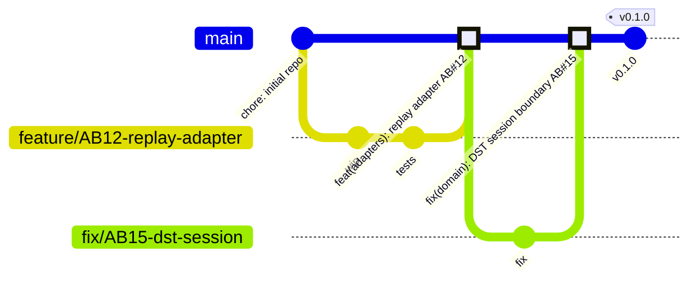

# Branching and release standard

| Field | Value |
|---|---|
| Status | Active |
| Owner | Solution Architect |
| Implements | [ADR 0002](../adr/0002-source-control-platform.md), [ADR 0003](../adr/0003-application-lifecycle-management.md), [ADR 0004](../adr/0004-ci-cd-platform.md) |
| Related | [ADR 0013](../adr/0013-adapter-control-plane.md) (feature flags via App Configuration), [ADR 0016](../adr/0016-environments-and-infrastructure-as-code.md) (environments) |

This standard describes **how** code moves from a work item to production. The decision **that** SignalLog uses trunk-based development is recorded in ADR 0002; this document is the operating procedure and can change through a normal pull request without a new ADR.

## 1. Model: trunk-based development

- `main` is the only long-lived branch. It is always releasable.
- All changes reach `main` through short-lived branches and pull requests.
- There are no `develop`, `release/*`, `hotfix/*` or environment branches (`dev`, `staging`, `prod`).

### Why not the alternatives

| Strategy | Why not for SignalLog |
|---|---|
| GitFlow | Built for products with several supported versions in parallel. SignalLog is a continuously delivered service with one running version; `develop` and `release/*` would add merge overhead and delay without benefit. The author of GitFlow added a note in 2020 recommending simpler workflows such as GitHub Flow for continuously delivered software. |
| Environment branches | Environments drift apart, and the build deployed to production is not the build that was tested. Environments are promoted by the pipeline instead (section 5). |
| Long-lived feature branches | Integration cost grows with branch age. Unfinished work is hidden behind feature flags instead (section 4). |



## 2. Branches

| Rule | Value |
|---|---|
| Scope | One branch per Azure Boards User Story or Bug |
| Name | `<type>/AB<id>-short-kebab-description` |
| Types | `feature`, `fix`, `refactor`, `docs`, `chore`, `ci`, `test` |
| Base | Always `main` |
| Lifetime | Target ≤ 1 working day, hard limit 2 working days |
| Sync | Update from `main` before merge (GitHub "Update branch") |

Examples: `feature/AB12-replay-adapter`, `fix/AB15-dst-session-boundary`, `docs/AB20-nfr-catalogue`.

A branch that cannot be merged within two days signals that the story is too large. Split the story on the board; do not extend the branch.

## 3. Commits and pull requests

- **Merge method:** squash merge only (enforced by repository settings and the `main-protection` ruleset).
- **PR title** becomes the single commit on `main`, so it must follow [Conventional Commits](https://www.conventionalcommits.org/) and reference the work item:

  ```text
  <type>(<scope>): <summary> AB#<id>
  ```

  Examples: `feat(adapters): add replay adapter AB#12`, `fix(domain): handle DST fall-back in session check AB#15`.
- **Scopes** follow the solution layout: `adapters`, `ingress`, `ingestion`, `api`, `web`, `domain`, `contracts`, `infra`, `docs`, `ci`.
- **Breaking changes** to the message contract or public API use `!` (`feat(contracts)!: ...`) and require a contract-version decision ([ADR 0012](../adr/0012-message-contract-and-versioning.md)).
- **Commits inside a branch** may be informal (`wip`, `fix typo`); they are squashed away.
- **Review:** the PR template's self-review checklist is mandatory; required status checks must pass (ADR 0002 explains why approvals are set to 0 in a solo project).
- **After merge** the head branch is deleted automatically.

## 4. Unfinished work: feature flags

Work that cannot be completed within the branch lifetime is merged **disabled**, not kept on a branch.

- Flags live in Azure App Configuration (free tier, already part of [ADR 0013](../adr/0013-adapter-control-plane.md)) and are read through `Microsoft.FeatureManagement`.
- Naming: `<area>:<feature>:enabled`, for example `adapters:eex-live:enabled`.
- Every flag has an owner work item and is removed after the feature is fully enabled; a flag older than one release is a tech-debt item on the board.

## 5. Environments and promotion

- Each merge to `main` builds **one set of artefacts**.
- The same artefacts deploy automatically to `dev`, then to `prod` after manual approval on the GitHub Environment `prod` ([ADR 0004](../adr/0004-ci-cd-platform.md)).
- Infrastructure changes follow the same path, with `what-if` output reviewed in the PR ([ADR 0016](../adr/0016-environments-and-infrastructure-as-code.md)).

## 6. Versioning and releases

- [Semantic Versioning](https://semver.org/): `vMAJOR.MINOR.PATCH`. The project stays on `0.x` until the first employer-facing demo, which becomes `v1.0.0`.
- A release is an annotated tag on a commit of `main` plus a GitHub Release.
- Release notes are generated from Conventional Commits: `feat` → Features, `fix` → Bug Fixes, `!` → Breaking Changes.
- Version bump rule: `feat` → MINOR, `fix`/`perf` → PATCH, breaking change → MAJOR (MINOR while on `0.x`).
- The traceability chain from [ADR 0003](../adr/0003-application-lifecycle-management.md) closes at the release: User Story → PR → commit on `main` → tag → deployment.

## 7. Hotfixes and rollback

- **Fix forward:** a production defect is fixed by a normal short-lived `fix/AB<id>-...` branch and PR, deployed by the regular pipeline.
- **Rollback:** redeploy the previous release's artefacts (re-run the deployment for that tag). Do not revert history on `main` to roll back an environment.
- If a fix must bypass `dev`, the reason is recorded on the Bug work item.

## 8. Exceptions

| Case | Rule |
|---|---|
| Dependabot branches (`dependabot/...`) | Same flow; the PR-title check exempts the `dependabot[bot]` author from the `AB#` requirement. |
| Documentation and ADR changes | Same flow (`docs/` type). ADR status changes are reviewed like code. |
| Emergency change to repository settings or rulesets | Recorded as a Bug or Issue work item with the reason; no bypass actors are configured in the ruleset. |

## 9. Enforcement

| Rule | Enforced by |
|---|---|
| No direct pushes, no force pushes, no deletion of `main` | Ruleset `main-protection` |
| Linear history, squash only | Ruleset + repository merge settings |
| PR title format and `AB#` | `ci.yml` PR-title lint (planned, ADR 0004) |
| Branch name format | Not enforced automatically; checked in self-review |
| Branch age ≤ 2 days | Visible on the Scrumban board (story cycle time) |
