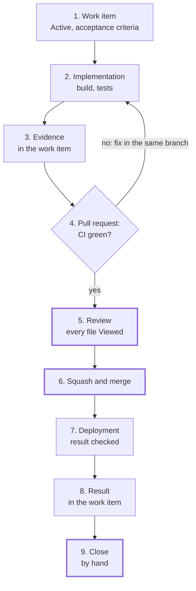

# Change workflow

| Field | Value |
|---|---|
| Status | Active |
| Owner | Solution Architect |
| Implements | [ADR 0002](../adr/0002-source-control-platform.md), [ADR 0003](../adr/0003-application-lifecycle-management.md), [ADR 0004](../adr/0004-ci-cd-platform.md) |
| Related | [Branching and release standard](branching-and-release.md) (branch names, commit format, releases), [Documentation standard](documentation.md) |

This standard describes how one change travels from an agreed idea to a closed work item. Branch names, commit format and releases are in the [branching and release standard](branching-and-release.md); this page adds what happens around them: the work item, the evidence, the review and the closure. It changes through a normal pull request without a new ADR.

## 1. Lifecycle

A change starts as a work item on the board **before** any work is done and ends when the owner closes it by hand. Automation prepares and checks; the owner makes the three decisions: the review, the merge and the closure.



Steps 5, 6 and 9 (thick border) are the owner's; nothing automates them.

| Step | What happens | Work item state | Board column |
|---|---|---|---|
| 1. Work item | User Story (or Feature, when no existing Feature fits) with title, area, tags (ADR, NFR) and acceptance criteria | Active | In Progress |
| 2. Implementation | Code, documentation, tests; everything named in the acceptance criteria is checked | Active | In Progress |
| 3. Evidence | A comment in the work item's Discussion: for each criterion, how it was checked and what came out; screenshots as attachments | Active | In Progress |
| 4. Pull request | Branch and title carry the work item id; `AB#<id>` in the description; CI runs | Resolved | Review |
| 5. Review | The owner reads the pull request and marks every file as Viewed; the review gate turns green (section 5) | Resolved | Review |
| 6. Merge | The owner presses **Squash and merge** | Resolved | Review |
| 7. Deployment | The workflow for the merge commit runs; the published result is checked against the acceptance criteria | Resolved | Review |
| 8. Result | A second comment: pull request, merge commit, deployment run, result checks | Resolved | Review |
| 9. Close | The owner moves the work item to Closed when satisfied | Closed | Done |

A red check sends the work back to the same branch; the evidence is updated with the fix.

## 2. Work items

- The work item is created as soon as a change is agreed, before the first line of work. Its acceptance criteria are the checklist for steps 3, 7 and 8.
- The desired state of the backlog is code: `eng/azure-devops/boards.settings.psd1`. The entry for a new work item goes into the same pull request as the work; `Initialize-AzureBoards.ps1` finds the existing item by type and title and does not duplicate it. The title is therefore not renamed afterwards.
- A change that fits no existing Feature gets a new Feature first; a story is not attached to whatever Feature is at hand.
- Work items are closed only by hand. Neither the scripts nor the GitHub integration close them.

## 3. Linking pull requests to work items

- A link from a pull request to a work item is created only by `AB#<id>` in the pull request **description** or in a commit message; `AB#` in the pull request title or in a comment creates no link ([Microsoft Learn](https://learn.microsoft.com/azure/devops/boards/github/link-to-from-github?view=azure-devops#use-ab-to-link-from-github-to-azure-boards-work-items), checked 2026-11-06). The title keeps `AB#<id>` as well, because the CI title check requires it and the squash commit takes the title.
- No transition keyword precedes `AB#`: not `fix`, `fixes`, `fixed`, and no state or category name (`Resolved`, `Closed`, `Done`). Such a keyword moves the work item to another state on merge (same source), which would bypass step 9.
- After the merge, the integration links the merge commit to the work item by itself ([Microsoft Learn](https://learn.microsoft.com/azure/devops/boards/github/features-timeline?view=azure-devops#delivered-features), checked 2026-11-06).

## 4. Pull request description

The description answers three questions: what changed, which acceptance criteria it meets, and how that was checked. The [pull request template](https://github.com/AlexeyGane/signallog/blob/main/.github/pull_request_template.md) carries these sections:

```markdown
## What

- **<file or area>**: <what changed and why, one line>.

Work item: AB#<id>

## Acceptance criteria

- [x] <criterion copied from the work item>

## Checks

- `<command>`: <result>.
- Evidence: <link to the evidence comment in the work item>.
```

A commit message body is wrapped at about 72 characters and its subject kept to about 50 ([T. Pope, 2008](https://tbaggery.com/2008/04/19/a-note-about-git-commit-messages.html)); the squash commit takes the pull request title as its subject.

## 5. Review gate: every file Viewed

A pull request is merged only after the owner has marked every changed file as Viewed. GitHub does not let authors approve their own pull requests and has no built-in rule for viewed files, so the gate has two parts:

- **On GitHub:** a ruleset on `main` requires a pull request, allows squash merges only ([merge method rule](https://github.blog/changelog/2024-12-04-pull-request-merge-method-rule-public-preview)) and requires the CI checks and the commit status `review/all-files-viewed`. Until that status is green, the merge button stays disabled.
- **On the owner's machine:** the change script asks GitHub, as the owner, for the `viewerViewedState` of every file in the pull request (GraphQL; values `VIEWED`, `UNVIEWED`, `DISMISSED`). It keeps the status `review/all-files-viewed` at *pending* with a count ("3 of 5 files viewed") and sets it to *success* on the head commit once every file is `VIEWED`.

A new push creates a new head commit without the status, so the gate closes again; files changed since they were viewed lose their Viewed mark and must be read again. The status can be set by anyone with write access, which in a single-owner repository is the owner: the gate guards against forgetting a file, not against deliberate bypass.

The ruleset part is introduced by its own work item; until it is in place, the script sets the status and the owner keeps to the rule.

## 6. Change script

Every change is applied on the owner's machine by one script. The script never merges and never closes a work item; it is safe to run again, skipping steps already done.

1. **Work item.** The work item exists and is Active (step 1 is done before the change is prepared).
2. **Base.** `git switch main`, `git pull --prune`. Files left by an interrupted run are restored only if they are byte-identical to the staged copies; any other uncommitted change stops the script.
3. **Baseline.** Each file the change touches must have, on `main`, the git blob id the change was verified against; a new file must be absent.
4. **Files and evidence.** Staged files are copied in; the evidence comment and screenshots go into the work item.
5. **Commit and pull request.** The staged blob ids are checked again, the commit is signed (an unsigned commit stops the script), pushed, and the pull request is created; the work item moves to Resolved.
6. **CI.** `gh pr checks --watch --fail-fast`; a red check stops the script.
7. **Review.** The pull request opens in the browser; the review gate (section 5) follows the Viewed marks.
8. **Merge.** The owner merges; the script waits for the pull request to be `MERGED` and stops if it is closed unmerged.
9. **Deployment and result.** The workflow run for the merge commit is watched to the end; the published result is checked against the acceptance criteria; the result comment goes into the work item.
10. **Clean-up.** The staging folder is removed.

Shared steps live in one tested PowerShell module, so that a change script holds only its parameters and its result checks.

## 7. Safeguards

| Check | Protects against | When it fires |
|---|---|---|
| No work item, or not Active | Work without an agreed goal and acceptance criteria | Create the work item first, then prepare the change |
| Blob id on `main` differs from the verified one | Overwriting someone else's change; an untested combination | Rebuild the change on the new `main` |
| Staged blob id differs after `git add` | A damaged copy or stray edits in the working tree | Stage the files again |
| No evidence comment before the pull request | A pull request with nothing checkable behind it | The script writes the comment before it pushes |
| Unsigned commit | Commits without a verifiable author | Check `gpg.format`, `user.signingkey`, `gpg.ssh.allowedSignersFile` |
| Red CI check | Merging something broken | Fix in the same branch and run the script again |
| Not every file Viewed | Merging something unread | Finish the review; the status turns green by itself |
| Result check fails after deployment | "Merged" taken for "works" | Wait for the Pages CDN and check by hand; the work item stays open |

Two rules hold by the split of roles rather than by the script: nothing outside the owner's machine runs git commands that write to the owner's working copy, and credentials (`az login`, the signing key, `gh auth`) exist only on the owner's machine.
